

# Software Requirements Specification

# Abstract

SafeBite is a mobile decision-support application that helps Pakistani consumers understand published heavy-metal evidence for packaged foods. Users scan a barcode or search a product to see reported concentrations of lead, cadmium, chromium, cobalt and copper from Pakistani studies, compared with applicable PSQCA limits, with Codex as a fallback and EU limits shown for reference. A deterministic engine computes concentration-to-limit ratios, a mean contamination index, and an optional A–F grade only when product-specific evidence is sufficient. Missing data is labelled “Not Tested” and never treated as zero. Evidence is marked product-, brand- or category-level, and every value links to its source. A retrieval-augmented assistant answers questions with citations and conservative language. The system uses React Native/Expo, Node.js/Express, and PostgreSQL with pgvector.

## Contents

- [1. Introduction](#1-introduction)
  - [1.1. Purpose](#11-purpose)
  - [1.2. Document Scope](#12-document-scope)
  - [1.3. Intended Audience](#13-intended-audience)
  - [1.4. System Overview](#14-system-overview)
  - [1.5. Definitions and Terminology](#15-definitions-and-terminology)
- [2. Vision Document](#2-vision-document)
  - [2.1. Problem Statement](#21-problem-statement)
  - [2.2. Business Opportunity](#22-business-opportunity)
  - [2.3. Motivation](#23-motivation)
  - [2.4. Objectives](#24-objectives)
  - [2.5. Scope](#25-scope)
    - [2.5.1. In Scope](#251-in-scope)
    - [2.5.2. Out of Scope](#252-out-of-scope)
  - [2.6. Constraints](#26-constraints)
  - [2.7. Stakeholder and User Descriptions](#27-stakeholder-and-user-descriptions)
    - [2.7.1. Market Demographics](#271-market-demographics)
    - [2.7.2. Stakeholder Summary](#272-stakeholder-summary)
    - [2.7.3. User Environment](#273-user-environment)
    - [2.7.4. Stakeholder Profiles](#274-stakeholder-profiles)
- [3. System Requirements Specification](#3-system-requirements-specification)
  - [3.1. System Features](#31-system-features)
  - [3.2. Functional Requirements](#32-functional-requirements)
    - [3.2.0. Global Rules](#320-global-rules)
    - [3.2.1. Barcode Product Scanner](#321-barcode-product-scanner)
    - [3.2.2. Product Search](#322-product-search)
    - [3.2.3. Heavy-Metal and Contaminant Analysis](#323-heavy-metal-and-contaminant-analysis)
    - [3.2.4. Threshold and Margin Analysis](#324-threshold-and-margin-analysis)
    - [3.2.5. Standardized Decision-Support Grading](#325-standardized-decision-support-grading)
    - [3.2.6. Cumulative Contamination Index](#326-cumulative-contamination-index)
    - [3.2.7. Heavy-Metal Result Interpretation](#327-heavy-metal-result-interpretation)
    - [3.2.8. Evidence-Based Alternative Recommendations](#328-evidence-based-alternative-recommendations)
    - [3.2.9. Product Comparison](#329-product-comparison)
    - [3.2.10. Evidence Level and Research Transparency](#3210-evidence-level-and-research-transparency)
    - [3.2.11. AI Food Safety Assistant](#3211-ai-food-safety-assistant)
    - [3.2.12. Search and Scan History](#3212-search-and-scan-history)
    - [3.2.13. Favorites and Watchlist](#3213-favorites-and-watchlist)
    - [3.2.14. User Authentication and Profiles](#3214-user-authentication-and-profiles)
    - [3.2.15. Offline Caching](#3215-offline-caching)
    - [3.2.16. Health-Context Interpretation](#3216-health-context-interpretation)
    - [3.2.17. Exposure-Reduction Guidance](#3217-exposure-reduction-guidance)
  - [3.3. Non-Functional Requirements](#33-non-functional-requirements)
    - [3.3.1. Usability](#331-usability)
    - [3.3.2. Performance](#332-performance)
    - [3.3.3. Security](#333-security)
    - [3.3.4. Privacy](#334-privacy)
    - [3.3.5. Reliability](#335-reliability)
    - [3.3.6. Accuracy and Transparency](#336-accuracy-and-transparency)
    - [3.3.7. Compatibility](#337-compatibility)
  - [3.4. Data Requirements](#34-data-requirements)
    - [3.4.1. Product Data](#341-product-data)
    - [3.4.2. Contaminant Measurement Data](#342-contaminant-measurement-data)
    - [3.4.3. Analysis Result Data](#343-analysis-result-data)
    - [3.4.4. Research and Labeled Heavy-Metal Data](#344-research-and-labeled-heavy-metal-data)
    - [3.4.5. Regulatory Standards Data](#345-regulatory-standards-data)
    - [3.4.6. User Data](#346-user-data)
    - [3.4.7. Health-Context Evidence Data](#347-health-context-evidence-data)
    - [3.4.8. Exposure-Reduction Guidance Data](#348-exposure-reduction-guidance-data)
    - [3.4.9. Local Cache Data](#349-local-cache-data)
    - [3.4.10. Vector Embedding Data](#3410-vector-embedding-data)
  - [3.5. Implementation Environment](#35-implementation-environment)
    - [3.5.1. Hardware Requirements](#351-hardware-requirements)
    - [3.5.2. Software Requirements](#352-software-requirements)
    - [3.5.3. Deployment Requirements](#353-deployment-requirements)
  - [3.6. Implementation Timeline](#36-implementation-timeline)
  - [3.7. Feature-to-Requirement Traceability](#37-feature-to-requirement-traceability)
  - [3.8. Assumptions](#38-assumptions)
- [4. Use Case Models](#4-use-case-models)
  - [4.1. Use Case Diagram](#41-use-case-diagram)
  - [4.2. High-Level Use Cases](#42-high-level-use-cases)
  - [4.3. Expanded Use Cases](#43-expanded-use-cases)
    - [4.3.1. UC-01: Scan Product](#431-uc-01-scan-product)
    - [4.3.2. UC-02: Search Product](#432-uc-02-search-product)
    - [4.3.3. UC-03: Analyze Contaminants](#433-uc-03-analyze-contaminants)
    - [4.3.4. UC-04: View Threshold and Margin Analysis](#434-uc-04-view-threshold-and-margin-analysis)
    - [4.3.5. UC-06: View Cumulative Contamination Index](#435-uc-06-view-cumulative-contamination-index)
    - [4.3.6. UC-11: Ask AI Food Safety Assistant](#436-uc-11-ask-ai-food-safety-assistant)
- [5. Structural Design Models](#5-structural-design-models)
  - [5.1. Domain Model](#51-domain-model)
  - [5.2. Class Diagram](#52-class-diagram)
  - [5.3. Layer Diagram](#53-layer-diagram)
- [6. Behavioral Design Models](#6-behavioral-design-models)
  - [6.1. Activity / Swimlane Diagram](#61-activity--swimlane-diagram)
  - [6.2. Flow Diagram](#62-flow-diagram)
  - [6.3. System Sequence Diagrams](#63-system-sequence-diagrams)
  - [6.4. Data Flow Diagram (DFD)](#64-data-flow-diagram-dfd)
    - [6.4.1. Context Diagram (Level 0)](#641-context-diagram-level-0)
    - [6.4.2. Level 1 Data Flow Diagram](#642-level-1-data-flow-diagram)
- [7. Database Design Models](#7-database-design-models)
  - [7.1. Entity Relationship Diagram](#71-entity-relationship-diagram)
- [8. Architecture and Deployment Models](#8-architecture-and-deployment-models)
  - [8.1. Architecture Diagram](#81-architecture-diagram)
  - [8.2. Deployment Diagram](#82-deployment-diagram)
- [9. Conclusion](#9-conclusion)
- [References](#references)

---

# 1. Introduction

## 1.1. Purpose

SafeBite is an intelligent food decision-support system designed to help users understand information related to packaged food products.

The system combines product identification, product information, research evidence, contaminant analysis, threshold and margin analysis, contamination assessment, heavy-metal result interpretation, evidence-based alternative recommendations, product comparison, and AI-based assistance.

The purpose of this Software Requirements Specification (SRS) is to define the requirements of the SafeBite system and establish a common reference for its design, development, testing, and evaluation.

This document also provides the foundation from which the system’s software engineering diagrams and other design artefacts will be developed.

## 1.2. Document Scope

The complete functional scope of SafeBite is defined by the master list of seventeen features in Section 3.1.

## 1.3. Intended Audience

This document is intended for:

- SafeBite project team members.
- Project supervisor.
- Software developers.
- Database designers.
- Software testers.
- Project evaluators.
- Other stakeholders involved in the development and evaluation of the project.

## 1.4. System Overview

The main system workflow is:

1. The user scans a barcode or searches by product name, brand, category, or barcode.

2. SafeBite retrieves the product and available research evidence.

3. SafeBite determines the applicable reference limits.

4. SafeBite calculates CLR, normalized margin, and CCI where valid comparable data exists.

5. SafeBite presents the result with its evidence level, sources, applicable optional grade, and data limitations.

6. The user may compare products, view evidence-based alternatives, or ask the AI Food Safety Assistant a question.

## 1.5. Definitions and Terminology

**Table 1: Definitions and Terminology**

| Term                              | Definition                                                                                                                                                                                                                                        |
| --------------------------------- | ------------------------------------------------------------------------------------------------------------------------------------------------------------------------------------------------------------------------------------------------- |
| SafeBite                          | The intelligent food decision-support system developed as the project.                                                                                                                                                                            |
| User                              | A person who interacts with SafeBite to search, scan, analyze, compare, or save food products.                                                                                                                                                    |
| Product                           | A packaged food product represented in the SafeBite system.                                                                                                                                                                                       |
| Barcode                           | A machine-readable identifier used to identify a product.                                                                                                                                                                                         |
| Contaminant Registry              | The set of contaminants for which SafeBite may store research measurements. The initial registry includes Pb, Cd, Cr, Co, and Cu. Inclusion in the registry does not imply that an applicable regulatory limit exists for every product category. |
| Evidence                          | Research or other available information used to support an analysis.                                                                                                                                                                              |
| Reference Limit                   | An applicable contaminant limit associated with a specific authority, standard version, jurisdiction, food category, product matrix, measurement basis, and unit.                                                                                 |
| CLR                               | Concentration-to-Limit Ratio; the ratio of a validated reported concentration to a directly comparable applicable reference limit.                                                                                                                |
| CCI                               | Cumulative Contamination Index; the arithmetic mean of valid CLRs for the contaminants eligible for inclusion in the calculation.                                                                                                                 |
| Analysis Result                   | A derived, versioned record containing selected reference limits, CLR, normalized margin, CCI, grade eligibility, exclusions, and other outputs calculated from one or more raw contaminant measurements.                                         |
| DOI                               | Digital Object Identifier. A unique alphanumeric string used to permanently identify and link to a digital document or object.                                                                                                                    |
| Evidence Level                    | The strength of the relationship between a research record and the selected item, classified as product-specific, brand-level, or category-level.                                                                                                 |
| Heavy-Metal Result Interpretation | A plain-language presentation of contaminant measurements, applicable reference comparisons, CLR and margin status, CCI, grade eligibility, evidence level, and missing-data limitations.                                                         |
| Recommendation                    | A suggested product alternative generated using comparable contaminant evidence and analysis.                                                                                                                                                     |
| PSQCA                             | Pakistan Standards and Quality Control Authority.                                                                                                                                                                                                 |
| Codex Alimentarius                | International food standards, guidelines, and codes of practice developed through the FAO/WHO Codex Alimentarius Commission.                                                                                                                      |
| RAG                               | Retrieval-Augmented Generation; a process that retrieves relevant SafeBite evidence before generating an answer.                                                                                                                                  |
| pgvector                          | A PostgreSQL extension used to store and search vector embeddings for semantic retrieval.                                                                                                                                                         |
| TTL                               | Time to live; the period for which a locally cached result remains valid. SafeBite uses a seven-day TTL for cached product results.                                                                                                               |
| Decision-Support Grade            | An optional A–F project-defined presentation grade derived from version-controlled CLR, CCI, evidence-eligibility, and missing-data rules. It is not a medical, toxicological, regulatory, or legal classification.                               |

# 2. Vision Document

## 2.1. Problem Statement

Pakistani consumers have no practical, product-centered mechanism for connecting packaged foods with published contamination research and regulatory limits. A joint study announced by UNICEF Pakistan and the Ministry of National Health Services on May 1, 2026 reported dangerous blood-lead levels in 40% of children aged 12–36 months in surveyed high-risk urban areas and identified contaminated food and spices among the important exposure sources [1].

Relevant studies report lead, cadmium, chromium, cobalt, and copper in Pakistani foods including sauces, bread, noodles, chocolates, milk, and tea [10, 11, 12, 13, 14, 15]. However, the findings remain distributed across scientific papers and use different samples, units, methods, and product relationships. Consumers must also interpret multiple standards, including PSQCA, Codex Alimentarius, and European Union contaminant limits, without a single interface that explains which category-, matrix-, and jurisdiction-specific limit applies. PSQCA standards themselves demonstrate that the covered contaminants and limits differ by product matrix: packaged liquid milk and bottled natural mineral water contain different contaminant schedules [6, 7]. The standards dataset shall retain the original issuing source and version [3, 4, 5].

SafeBite addresses this information asymmetry by linking barcode and text-based product identification to structured research evidence, deterministic analysis, transparent source attribution, comparable products, and medically conservative explanations. The system does not perform laboratory testing and does not treat missing evidence as proof that a product is safe.

## 2.2. Business Opportunity

The food contamination dataset could later serve NGOs, nutritionists, researchers and food authorities through an evidence-linked API. The app is free for consumers. Sustainability could come from grants, institutional licences, or an API for health organisations.

## 2.3. Motivation

The proposal identifies childhood lead exposure as a significant Pakistani public-health and data-access problem. UNICEF estimates the annual loss of economic potential associated with lead exposure in Pakistan at approximately USD 25–35 billion [1]. SafeBite cannot eliminate exposure or replace public health intervention, but it can reduce the information gap between published evidence and consumer product decisions.

The project supports United Nations Sustainable Development Goal 3 by improving access to information about hazardous chemical exposure, Goal 12 by encouraging transparent and responsible consumption, and Goal 9 by developing domestic digital infrastructure for research accessibility [2].

## 2.4. Objectives

The objectives of SafeBite are:

1. To build a React Native and Expo application for Android and iOS with barcode and text lookup for at least 200 Pakistani packaged-food products.

2. To build and document a PostgreSQL repository of more than 260 labeled Pakistani product heavy-metal sample records with source metadata [8], together with a standards matrix covering PSQCA, Codex Alimentarius, and applicable European Union limits.

3. To implement a deterministic and reproducible analysis engine that selects reference limits by applicability and calculates CLR, normalized margin, CCI, and an optional Decision-Support Grade under a versioned rule set without treating missing data as zero.

4. To present results with their evidence level, sources, and limitations in plain language, to provide comparisons or alternative recommendations only from comparable product-specific evidence, and, for opted-in users, evidence-cited health-context notes and exposure-reduction guidance..

5. To provide a citation-grounded RAG assistant that refuses or flags requests when the retrieved evidence is insufficient.

6. To provide user accounts, search and scan history, favorites, watchlist functionality, and a seven-day offline cache.

7. To evaluate SafeBite against the calculation-accuracy, RAG faithfulness, usability, and performance requirements defined in Sections 3.2 and 3.3.

## 2.5. Scope

### 2.5.1. In Scope

The complete in-scope functionality is defined by the master list of seventeen features in Section 3.1.

### 2.5.2. Out of Scope

SafeBite is a food decision-support system rather than a medical diagnosis or treatment system.

The following are outside the intended scope:

- Laboratory testing.
- Medical diagnosis and treatment.
- Replacing healthcare professionals.
- User-submitted data and non-Pakistani products.
- An administrative dashboard in the initial release.
- Presenting system assessments as guaranteed medical outcomes.

## 2.6. Constraints

The SafeBite system is subject to the following constraints:

1. Analysis quality is limited by data availability. Many products lack product-specific evidence, and some contaminants lack measurements or applicable reference limits.

2. Reference limits must be tied to contaminant, food category, product matrix, jurisdiction, measurement basis, unit, standard version, and source; consequently, many measurements may be non-comparable.

3. Product-level CCI, grades, interpretations, and recommendations require comparable product-specific evidence.

4. Live search, authentication, and the AI assistant require internet connectivity. Only previously cached results remain available offline for seven days.

5. AI output depends on external providers and retrieved data. Provider failures shall not affect stored evidence or deterministic analysis results.

6. The mobile compatibility targets are Android API 28 or later and iOS 16 or later.

7. Deployment is limited to the project’s AWS budget and the proposed EC2 t2.micro, RDS db.t3.micro, and S3 resources.

8. SafeBite provides decision support only and does not perform laboratory testing, medical diagnosis, or dietary-exposure estimation.

## 2.7. Stakeholder and User Descriptions

### 2.7.1. Market Demographics

The primary target users are Pakistani consumers who purchase packaged foods and use Android or iOS smartphones. The initial catalog target is at least 200 locally available packaged products. The system is designed for users who may have limited scientific literacy and need research findings, contaminant ratios, and evidence limitations translated into clear language.

The system is intended to support users who are interested in:

- Food safety.
- Contaminant information.
- Heavy-metal result interpretation.
- Applicable reference limits and evidence limitations.
- Comparing similar products.
- Understanding research evidence.

### 2.7.2. Stakeholder Summary

**Table 2: Stakeholder Summary**

| Stakeholder            | Role                          | Interest                                                                                                                                                              |
| ---------------------- | ----------------------------- | --------------------------------------------------------------------------------------------------------------------------------------------------------------------- |
| User / Consumer        | Primary system user           | Searches, scans, analyzes, compares, and saves food products.                                                                                                         |
| Project Team           | Development team              | Designs, develops, tests, and documents SafeBite.                                                                                                                     |
| Project Supervisor     | Academic supervisor           | Reviews and guides the requirements, design, implementation, and documentation.                                                                                       |
| Research / Data Source | External information source   | Provides the 260+ labeled Pakistani product heavy-metal records [8], supporting research evidence, product information, and source metadata integrated into SafeBite. |
| Standards Authority    | Regulatory information source | Provides contaminant limits and applicability rules through PSQCA, Codex Alimentarius, and European Union standards.                                                  |
| Project Evaluator      | Evaluation stakeholder        | Evaluates the completed project and its artefacts.                                                                                                                    |

### 2.7.3. User Environment

SafeBite is a React Native and Expo mobile application targeting Android API 28 or later and iOS 16 or later. Barcode scanning requires a functioning device camera. Live lookup, authentication, semantic evidence retrieval, and AI assistance require internet connectivity.

Users may not have technical knowledge of food research, contaminant analysis, or data interpretation.

Therefore, SafeBite shall present complex information in a simple manner while retaining relevant research transparency. Previously retrieved product results may be displayed from the seven-day local cache when connectivity is unavailable, but the interface shall label them as cached and shall not present expired entries as current data.

### 2.7.4. Stakeholder Profiles

#### 2.7.4.1. User / Consumer

The user is the primary actor of the SafeBite system.

The user can:

- Scan products.
- Search for products.
- View product information.
- View contaminant analysis.
- View contamination assessment.
- View a plain-language heavy-metal result interpretation.
- View evidence-based alternatives.
- Compare products.
- Ask questions using the AI Food Safety Assistant.
- View search and scan history.
- Manage favorites.
- Manage the watchlist.
- Optionally record, view, edit, or delete consented health-context tags.
- View cited health-context interpretation and exposure-reduction guidance.

#### 2.7.4.2. Project Team

The project team is responsible for:

- Requirements analysis.
- System design.
- Database design.
- Software implementation.
- Testing.
- Documentation.
- Maintenance of the project artefacts.

#### 2.7.4.3. Project Supervisor

The supervisor is responsible for reviewing the project and providing academic guidance and feedback.

# 3. System Requirements Specification

## 3.1. System Features

The SafeBite system consists of the following seventeen major features.

1. Barcode Product Scanner

2. Product Search

3. Heavy-Metal and Contaminant Analysis

4. Threshold and Margin Analysis

5. Standardized Decision-Support Grading

6. Cumulative Contamination Index (CCI)

7. Heavy-Metal Result Interpretation

8. Evidence-Based Alternative Recommendations

9. Product Comparison

10. Evidence Level and Research Transparency

11. AI Food Safety Assistant

12. Search and Scan History

13. Favorites and Watchlist

14. User Authentication and Profiles

15. Offline Caching

16. Health-Context Interpretation

17. Exposure-Reduction Guidance

## 3.2. Functional Requirements

### 3.2.0. Global Rules

The following rules apply to every SafeBite feature and analysis workflow.

**Table 3: Global Rules**

| ID    | Global Rule                                                                                                                                                                                                                                                                                                                                           |
| ----- | ----------------------------------------------------------------------------------------------------------------------------------------------------------------------------------------------------------------------------------------------------------------------------------------------------------------------------------------------------- |
| GR-01 | Unavailable values shall never be treated as zero or as evidence of safety. The system shall display “Not Tested”, “No Applicable Limit Found”, “Not Comparable”, or “Insufficient Data”, together with the reason.                                                                                                                                   |
| GR-02 | Every research-derived value shall display its evidence level as product-specific, brand-level, or category-level. The system shall never imply that the exact product was tested when the available evidence does not establish that relationship.                                                                                                   |
| GR-03 | Only product-specific evidence that satisfies the active rule set shall be eligible to produce a CCI, Decision-Support Grade, or automatic alternative recommendation.                                                                                                                                                                                |
| GR-04 | CLR, CCI, and the Decision-Support Grade are concentration-comparison outputs. They shall not be presented as an exposure estimate, toxicological risk assessment, diagnosis, compliance certification, or guarantee of safety. Health-context notes are informational and never a verdict on safety for the user.                                    |
| GR-05 | The system shall display only status texts defined in the Status Catalogue, each with its reason code, and shall define these exact strings once in a shared enumeration consumed by the backend, mobile interface, and assistant explanations. Automated backend, mobile, and contract tests shall assert the exact text of every enumeration value. |

#### Status Catalogue

Every status text shown to the user shall be exactly one of the strings in Table 4. No requirement, screen or diagram may introduce a different wording for the same condition (GR-05). Each displayed status shall be accompanied by its reason code (Table 5).

**Table 4: Status Catalogue**

| ID                                                         | Display text                       | Trigger                                                                                                                                                                                                              |
| ---------------------------------------------------------- | ---------------------------------- | -------------------------------------------------------------------------------------------------------------------------------------------------------------------------------------------------------------------- |
| **A. Per-contaminant comparison status**                   |                                    |                                                                                                                                                                                                                      |
| ST-01                                                      | “Below Limit”                      | 0 ≤ CLR < 0.80                                                                                                                                                                                                       |
| ST-02                                                      | “Close to Limit”                   | 0.80 ≤ CLR < 1.00                                                                                                                                                                                                    |
| ST-03                                                      | “At Limit”                         | CLR = 1.00 (exact decimal equality)                                                                                                                                                                                  |
| ST-04                                                      | “Above Limit”                      | CLR > 1.00                                                                                                                                                                                                           |
| ST-05                                                      | “Not Tested”                       | No usable measurement exists for the contaminant                                                                                                                                                                     |
| ST-06                                                      | “No Applicable Limit Found”        | Measurement exists but no applicable reference limit is selected                                                                                                                                                     |
| ST-07                                                      | “Not Comparable”                   | Measurement and limit exist but cannot be compared (unit, basis, range, below detection limit, non-current limit)                                                                                                    |
| **B. Per-product analysis status**                         |                                    |                                                                                                                                                                                                                      |
| ST-08                                                      | “Insufficient Data”                | CCI, grade, interpretation, comparison or recommendation cannot be produced (no research record, evidence not product-specific, minimum eligible contaminants not met, no comparable results, rule-version mismatch) |
| **C. Lookup, cache, assistant, and health-context status** |                                    |                                                                                                                                                                                                                      |
| ST-09                                                      | “Product Not Found”                | Barcode or text query matches no catalogue product                                                                                                                                                                   |
| ST-10                                                      | “Cached Result”                    | Result displayed from local cache within the 7-day TTL                                                                                                                                                               |
| ST-11                                                      | “Cached Data Expired”              | Cached entry older than the TTL                                                                                                                                                                                      |
| ST-12                                                      | “Assistant Unavailable”            | AI provider failed or timed out                                                                                                                                                                                      |
| ST-13                                                      | “No Supporting Evidence Found”     | Retrieval returned nothing above the similarity threshold, or citation validation failed                                                                                                                             |
| ST-14                                                      | “No Health-Context Evidence Found” | No reviewed Health-Context Evidence record matches the measured contaminant and user tag                                                                                                                             |

**Table 5: Reason Codes**

| Code                            | Meaning                                                                                  |
| ------------------------------- | ---------------------------------------------------------------------------------------- |
| `NO_MEASUREMENT`                | Value blank, not tested or not reported                                                  |
| `NO_LIMIT`                      | No limit for this contaminant and category in any permitted tier                         |
| `UNIT_MISSING`, `UNIT_MISMATCH` | Unit absent, or measurement and limit units cannot be reconciled                         |
| `BASIS_MISMATCH`                | Wet/dry or mass/volume basis differs                                                     |
| `RANGE_VALUE`                   | Source reports a range instead of a value                                                |
| `BELOW_LOD`                     | Reported as ND or “<” a detection limit                                                  |
| `LIMIT_NOT_CURRENT`             | Only a legacy or superseded limit exists                                                 |
| `NOT_PRODUCT_SPECIFIC`          | Evidence is brand- or category-level                                                     |
| `MIN_ELIGIBLE_NOT_MET`          | Fewer than kmin eligible contaminants, or neither Pb nor Cd eligible          |
| `NO_RESEARCH_RECORD`            | No research record for the product                                                       |
| `NO_COMPARABLE_RESULTS`         | Comparison or alternatives impossible on a common contaminant set                        |
| `RULE_VERSION_MISMATCH`         | Results computed under different rule versions                                           |
| `NO_HEALTH_CONTEXT_EVIDENCE`    | No reviewed health-context evidence record matches the measured contaminant and user tag |

### 3.2.1. Barcode Product Scanner

The Barcode Product Scanner allows users to scan packaged food products using the device camera.

**Table 6: Barcode Product Scanner Functional Requirements**

| ID       | Functional Requirement                                                                                                      |
| -------- | --------------------------------------------------------------------------------------------------------------------------- |
| FR-01-01 | The system shall allow the user to activate the barcode scanner.                                                            |
| FR-01-02 | The system shall use the device camera to scan the product barcode.                                                         |
| FR-01-03 | The system shall decode EAN-13 and UPC-A barcode values.                                                                    |
| FR-01-04 | The system shall transmit the decoded barcode to the backend REST API for product lookup.                                   |
| FR-01-05 | The system shall retrieve available product information for a matched barcode.                                              |
| FR-01-06 | The system shall display “Product Not Found” when the scanned barcode cannot be matched with available product information. |
| FR-01-07 | The scanner shall operate through the supported Expo camera and barcode scanning capabilities on Android and iOS devices.   |

### 3.2.2. Product Search

The Product Search feature allows users to search for products when barcode scanning is unavailable or when the user prefers manual search.

**Table 7: Product Search Functional Requirements**

| ID       | Functional Requirement                                                       |
| -------- | ---------------------------------------------------------------------------- |
| FR-02-01 | The system shall allow the user to search using product name.                |
| FR-02-02 | The system shall allow the user to search using brand name.                  |
| FR-02-03 | The system shall allow the user to search using food category.               |
| FR-02-04 | The system shall allow the user to search using barcode.                     |
| FR-02-05 | The system shall display matching products.                                  |
| FR-02-06 | The system shall allow the user to select a product from the search results. |

### 3.2.3. Heavy-Metal and Contaminant Analysis

SafeBite shall store and display available contaminant measurements reported in research evidence. The initial supported contaminant registry includes:

- Lead (Pb).
- Cadmium (Cd).
- Chromium (Cr).
- Cobalt (Co).
- Copper (Cu).

The presence of a contaminant in the research dataset shall not imply that an applicable regulatory limit exists for every food category or product matrix. Regulatory applicability shall be determined separately for each contaminant and product context.

**Table 8: Heavy-Metal and Contaminant Analysis Functional Requirements**

| ID       | Functional Requirement                                                                                                                                                                                                                                 |
| -------- | ------------------------------------------------------------------------------------------------------------------------------------------------------------------------------------------------------------------------------------------------------ |
| FR-03-01 | The system shall identify available contaminant measurements associated with a selected product, brand, or food category.                                                                                                                              |
| FR-03-02 | The system shall display reported concentration values when available.                                                                                                                                                                                 |
| FR-03-03 | The system shall display the measurement unit and measurement basis.                                                                                                                                                                                   |
| FR-03-04 | The system shall display available research details, including the research source, title, authors, publication year, journal, DOI or URL, study location, sample size, methodology, and analytical method when those fields are available.            |
| FR-03-05 | The system shall identify the measurement status.                                                                                                                                                                                                      |
| FR-03-06 | The system shall distinguish a valid measured concentration, an unavailable measurement, and a measurement for which no applicable reference limit is available.                                                                                       |
| FR-03-07 | The system shall retrieve evidence in the order product-specific, brand-level, and then category-level for research discovery. Retrieval of less-direct evidence shall not automatically make that evidence eligible for a product-level CCI or grade. |

### 3.2.4. Threshold and Margin Analysis

Threshold and Margin Analysis compares reported concentrations with applicable reference limits.

For contaminant i, SafeBite shall use the Concentration-to-Limit Ratio (CLR):

$$CLR_i = \frac{C_i}{L_i} \qquad (3.1)$$

where Cᵢ is the validated reported concentration and Lᵢ is an applicable reference limit for the same contaminant, food category, product matrix, jurisdiction, measurement basis, and unit. The normalized margin is:

$$Margin_i = 1 - CLR_i \qquad (3.2)$$

A negative margin indicates that the selected reference limit has been exceeded. CLR is a concentration comparison, not an estimate of dietary exposure or health risk; exposure calculations require additional inputs such as intake and body weight [9].

**Table 9: Threshold and Margin Analysis Functional Requirements**

| ID       | Functional Requirement                                                                                                                                                                                                                                                                                                                                                                                                                        |
| -------- | --------------------------------------------------------------------------------------------------------------------------------------------------------------------------------------------------------------------------------------------------------------------------------------------------------------------------------------------------------------------------------------------------------------------------------------------- |
| FR-04-01 | For products intended for the Pakistani market, the system shall use an applicable PSQCA limit as the primary national reference where one is available. Where no applicable PSQCA limit exists, an applicable Codex limit may be used as an international fallback. Applicable European Union limits may be displayed as secondary comparisons.                                                                                              |
| FR-04-02 | The system shall determine applicability by contaminant, food category, product matrix, jurisdiction, measurement basis, unit, standard version, and effective date. It shall not select a reference solely because its numeric value is lower than another reference. The selected PSQCA primary or Codex fallback reference shall provide the CLR used in CCI and grading; any EU comparison CLR shall be labeled and displayed separately. |
| FR-04-03 | The system shall calculate CLR only when Cᵢ and Lᵢ are valid and directly comparable.                                                                                                                                                                                                                                                                                                                                                         |
| FR-04-04 | The system shall calculate the normalized margin as Marginᵢ = 1 − CLRᵢ.                                                                                                                                                                                                                                                                                                                                                                       |
| FR-04-05 | The system shall classify a valid CLR using the following non-overlapping bands: 0 ≤ CLRᵢ < 0.80 as “Below Limit”, 0.80 ≤ CLRᵢ < 1.00 as “Close to Limit”, CLRᵢ = 1.00 as “At Limit”, and CLRᵢ > 1.00 as “Above Limit”.                                                                                                                                                                                                                       |
| FR-04-06 | The system shall state that the 0.80 close-to-limit boundary is a SafeBite presentation rule and is not a regulatory or toxicological threshold.                                                                                                                                                                                                                                                                                              |
| FR-04-07 | The system shall display “Not Tested”, “No Applicable Limit Found”, or “Not Comparable” when the corresponding CLR inputs are unavailable or incompatible.                                                                                                                                                                                                                                                                                    |
| FR-04-08 | The system shall display the selected reference’s issuing authority, standard identifier, standard version, jurisdiction, contaminant, food category, product matrix, measurement basis, numeric limit, unit, effective date, applicability notes, and source URL.                                                                                                                                                                            |

### 3.2.5. Standardized Decision-Support Grading

SafeBite may produce an optional A–F Decision-Support Grade from the maximum valid CLR, the CCI, evidence eligibility, and missing-data status. The grade is a project-defined deterministic presentation rule, not a scientifically validated safety classification. The complete mapping shall be maintained as a version-controlled analysis rule set.

**Table 10: Standardized Decision-Support Grading Functional Requirements**

| ID       | Functional Requirement                                                                                                                                                                                                             |
| -------- | ---------------------------------------------------------------------------------------------------------------------------------------------------------------------------------------------------------------------------------- |
| FR-05-01 | The system shall calculate an optional A–F Decision-Support Grade using the active version-controlled deterministic rule set.                                                                                                      |
| FR-05-02 | The system shall display the grade with the maximum valid CLR, CCI, contributing measurements, selected reference limits, evidence level of each measurement, and missing or excluded contaminants.                                |
| FR-05-03 | The system shall display “Insufficient Data” instead of an A–F grade when the evidence does not satisfy the active eligibility rules.                                                                                              |
| FR-05-04 | The grade calculation shall be deterministic: identical validated inputs and the same rule version shall produce the same grade.                                                                                                   |
| FR-05-05 | The active rule set shall define the minimum evidence level, minimum number of eligible contaminant measurements, treatment of missing and ineligible contaminants, treatment of CLR and CCI values, and every A–F grade boundary. |

### 3.2.6. Cumulative Contamination Index

SafeBite includes the Cumulative Contamination Index (CCI) as a normalized contamination-comparison feature.

For k eligible contaminants, the CCI is:

$$CCI = \frac{1}{k}\sum_{i=1}^{k} CLR_i \qquad (3.3)$$

where:

- CLRᵢ is the valid Concentration-to-Limit Ratio for contaminant i.
- k is the number of eligible contaminants having both a validated measured concentration and an applicable, directly comparable reference limit.

Eligible contaminants contribute equally. Untested contaminants, missing measurements, contaminants without an applicable reference limit, and measurements that cannot be converted to a comparable unit or measurement basis are excluded rather than assigned zero.

**Table 11: Cumulative Contamination Index Functional Requirements**

| ID       | Functional Requirement                                                                                                                                                              |
| -------- | ----------------------------------------------------------------------------------------------------------------------------------------------------------------------------------- |
| FR-06-01 | The system shall calculate CCI as the arithmetic mean of the valid CLRs for eligible contaminants.                                                                                  |
| FR-06-02 | The system shall include a contaminant only when it has a validated measured concentration and an applicable, directly comparable reference limit.                                  |
| FR-06-03 | Eligible contaminants shall contribute equally. No contaminant-specific weight shall be applied unless a future rule version documents a scientifically justified weighting method. |
| FR-06-04 | The system shall identify every contaminant included in or excluded from the CCI and the reason for each exclusion.                                                                 |
| FR-06-05 | The system shall report the number of tested, eligible, missing, ineligible, and no-applicable-limit contaminants.                                                                  |
| FR-06-06 | The system shall display “Insufficient Data” when the minimum number of eligible contaminant measurements defined by the active rule version is unavailable.                        |

### 3.2.7. Heavy-Metal Result Interpretation

SafeBite shall translate the deterministic contaminant-analysis output into a concise interpretation that explains what was measured, which reference was applied, how the numerical comparison should be read, and which evidence limitations affect the result.

**Table 12: Heavy-Metal Result Interpretation Functional Requirements**

| ID       | Functional Requirement                                                                                                                                                                                                                                           |
| -------- | ---------------------------------------------------------------------------------------------------------------------------------------------------------------------------------------------------------------------------------------------------------------- |
| FR-07-01 | The system shall provide a plain-language interpretation for each completed contaminant analysis.                                                                                                                                                                |
| FR-07-02 | For each reported contaminant, the interpretation shall identify the measured concentration, unit, measurement basis, CLR, normalized margin, and comparison status when those values are available. Selected-reference details shall be presented per FR-04-08. |
| FR-07-03 | The interpretation shall present comparison and unavailable-data statuses per FR-04-05 and GR-01.                                                                                                                                                                |
| FR-07-04 | The system shall identify the highest eligible CLR and the contaminants included in the CCI and Decision-Support Grade so the principal drivers of the result are visible.                                                                                       |
| FR-07-05 | The interpretation shall state whether each finding is supported by product-specific, brand-level, or category-level evidence and shall explain when evidence does not apply directly to the scanned product.                                                    |
| FR-07-06 | The interpretation shall identify included and excluded contaminants and their exclusion reasons per FR-06-04.                                                                                                                                                   |
| FR-07-07 | When the available inputs cannot support a reliable interpretation, the system shall display “Insufficient Data” and identify the missing or ineligible inputs.                                                                                                  |

### 3.2.8. Evidence-Based Alternative Recommendations

SafeBite may recommend similar products when directly comparable product-specific contaminant evidence is available. The recommendation describes the reported comparison and does not claim that a product is universally or inherently safer.

**Table 13: Evidence-Based Alternative Recommendations Functional Requirements**

| ID       | Functional Requirement                                                                                                                                                                                                                                                   |
| -------- | ------------------------------------------------------------------------------------------------------------------------------------------------------------------------------------------------------------------------------------------------------------------------ |
| FR-08-01 | The system shall automatically identify candidate alternatives from the same food category.                                                                                                                                                                              |
| FR-08-02 | The system shall include a candidate only when it has a directly comparable, product-specific Analysis Result generated under the same active rule version.                                                                                                              |
| FR-08-03 | The system shall rank eligible candidates using the existing Analysis Results and shall state the reported comparison supporting each recommendation.                                                                                                                    |
| FR-08-04 | The system shall display “Insufficient Data” with reason code `NO_COMPARABLE_RESULTS` rather than recommend an alternative when the required product-specific inputs are missing or not comparable, and shall not infer safety from untested or category-level evidence. |

### 3.2.9. Product Comparison

SafeBite allows users to compare two or more similar products.

**Table 14: Product Comparison Functional Requirements**

| ID       | Functional Requirement                                                                                       |
| -------- | ------------------------------------------------------------------------------------------------------------ |
| FR-09-01 | The system shall allow the user to select two or more products for comparison.                               |
| FR-09-02 | The system shall display the selected products’ existing Analysis Results side by side.                      |
| FR-09-03 | The system shall identify results that use different rule versions or are otherwise not directly comparable. |
| FR-09-04 | The system shall label missing or unavailable information and shall not replace it with zero.                |

### 3.2.10. Evidence Level and Research Transparency

SafeBite provides transparency regarding the evidence used for its analysis.

Evidence categories include:

- Product-specific.
- Brand-level.
- Category-level.
- Limited evidence.
- Evidence insufficient for product-level analysis, reported as “Insufficient Data”.

A research record may include:

- Title.
- Authors.
- Year.
- Journal.
- Location.
- Sample size.
- Research method.
- Source link.
- DOI.

**Table 15: Evidence Level and Research Transparency Functional Requirements**

| ID       | Functional Requirement                                                                                                        |
| -------- | ----------------------------------------------------------------------------------------------------------------------------- |
| FR-10-01 | The system shall identify the strength/type of evidence supporting an analysis.                                               |
| FR-10-02 | The system shall provide a tappable DOI or source URL that opens the original research source when a valid link is available. |

### 3.2.11. AI Food Safety Assistant

SafeBite provides an AI Food Safety Assistant for user questions.

Example questions include:

- What does this result mean?
- Why is lead harmful?
- What does this contamination level mean?
- Why is this product a higher concern?
- What are the main factors affecting this result?

**Table 16: AI Food Safety Assistant Functional Requirements**

| ID       | Functional Requirement                                                                                                                                                                                                                                                                                                                                  |
| -------- | ------------------------------------------------------------------------------------------------------------------------------------------------------------------------------------------------------------------------------------------------------------------------------------------------------------------------------------------------------- |
| FR-11-01 | The system shall allow users to ask questions through the AI Food Safety Assistant.                                                                                                                                                                                                                                                                     |
| FR-11-02 | The assistant shall provide simple explanations of SafeBite results.                                                                                                                                                                                                                                                                                    |
| FR-11-03 | The assistant shall explain relevant food-safety concepts when requested.                                                                                                                                                                                                                                                                               |
| FR-11-04 | The assistant shall retrieve relevant SafeBite product, standard, and research records through the RAG pipeline before generating an answer.                                                                                                                                                                                                            |
| FR-11-05 | The assistant shall provide explanations in understandable language.                                                                                                                                                                                                                                                                                    |
| FR-11-06 | When retrieval produces no valid supporting evidence, the assistant shall display “No Supporting Evidence Found”. When the AI provider fails or times out, it shall display “Assistant Unavailable”.                                                                                                                                                    |
| FR-11-07 | When relevant, the assistant shall provide cited, informational health-context information from reviewed Health-Context Evidence records. It shall not diagnose a condition, prescribe or recommend treatment, estimate the user’s individual exposure, or state that a product is safe or unsafe for the user.                                         |
| FR-11-08 | The assistant shall attach citations to factual claims derived from SafeBite research records and shall reject unsupported source references during citation validation.                                                                                                                                                                                |
| FR-11-09 | When asked for diagnosis, treatment, or individualized medical advice, or whether exercise, sweating, supplements, detox products, or diets remove metals from the body, the assistant shall decline to make those claims. It may provide relevant cited health-context information and shall advise consulting a doctor or dietitian when appropriate. |

### 3.2.12. Search and Scan History

SafeBite maintains a history of scanned and searched products.

**Table 17: Search and Scan History Functional Requirements**

| ID       | Functional Requirement                                                                                                                         |
| -------- | ---------------------------------------------------------------------------------------------------------------------------------------------- |
| FR-12-01 | The system shall maintain the user’s search history.                                                                                           |
| FR-12-02 | The system shall maintain the user’s scan history.                                                                                             |
| FR-12-03 | The system shall allow the user to access previously viewed product information.                                                               |
| FR-12-04 | The system shall support later product comparison using previously viewed products.                                                            |
| FR-12-05 | The mobile application shall maintain recent search and scan entries in local AsyncStorage for quick access, subject to user privacy controls. |

### 3.2.13. Favorites and Watchlist

SafeBite allows users to save products for future use.

**Table 18: Favorites and Watchlist Functional Requirements**

| ID       | Functional Requirement                                                                                                            |
| -------- | --------------------------------------------------------------------------------------------------------------------------------- |
| FR-13-01 | The system shall allow the user to save a product as a favorite.                                                                  |
| FR-13-02 | The system shall allow the user to add a product to the watchlist.                                                                |
| FR-13-03 | The system shall allow the user to view favorite products.                                                                        |
| FR-13-04 | The system shall allow the user to view watchlist products.                                                                       |
| FR-13-05 | The system shall allow the user to remove a product from favorites.                                                               |
| FR-13-06 | The system shall allow the user to remove a product from the watchlist.                                                           |
| FR-13-07 | The system shall identify when updated product evidence or a revised assessment is available for an item on the user’s watchlist. |

### 3.2.14. User Authentication and Profiles

SafeBite uses authenticated profiles to associate account data, history, favorites, and watchlist data with the correct user. A user’s optional Health Profile contains only user-selected health-context tags and their consent state; it is governed by FR-16 and is not required by other features.

**Table 19: User Authentication and Profiles Functional Requirements**

| ID       | Functional Requirement                                                                                                                                                                                 |
| -------- | ------------------------------------------------------------------------------------------------------------------------------------------------------------------------------------------------------ |
| FR-14-01 | The system shall allow a user to create an account using the specified registration fields.                                                                                                            |
| FR-14-02 | The system shall allow a registered user to sign in and sign out.                                                                                                                                      |
| FR-14-03 | The system shall associate history, favorites, and watchlist entries with the authenticated account.                                                                                                   |
| FR-14-04 | The system shall prevent one user from accessing another user’s private profile data.                                                                                                                  |
| FR-14-05 | The system shall allow the user to view and update supported account profile fields, including optional health-context tags, subject to the consent and tag-management rules in FR-16-01 and FR-16-02. |
| FR-14-06 | The mobile application shall handle expired or invalid authentication sessions by requesting the user to authenticate again.                                                                           |

### 3.2.15. Offline Caching

SafeBite provides limited offline access to product results that were successfully retrieved while the device was online.

**Table 20: Offline Caching Functional Requirements**

| ID       | Functional Requirement                                                                                                                                                                     |
| -------- | ------------------------------------------------------------------------------------------------------------------------------------------------------------------------------------------ |
| FR-15-01 | The mobile application shall cache previously accessed product details and completed analysis results in local AsyncStorage.                                                               |
| FR-15-02 | Each cached result shall store its retrieval timestamp and shall remain valid for a seven-day TTL.                                                                                         |
| FR-15-03 | When the device is offline, the system shall display a valid cached result and identify it as “Cached Result”.                                                                             |
| FR-15-04 | The system shall identify a cached entry older than the seven-day TTL as “Cached Data Expired” and shall refresh it when connectivity returns before presenting it as current information. |
| FR-15-05 | The system shall explain that live authentication, uncached search, and AI assistant requests are unavailable without network connectivity.                                                |

### 3.2.16. Health-Context Interpretation

This optional feature presents curated, cited research context for user-selected health-context tags. It does not estimate the user’s exposure or provide a personal medical assessment.

**Table 21: Health-Context Interpretation Functional Requirements**

| ID       | Functional Requirement                                                                                                                                                                                                                 |
| -------- | -------------------------------------------------------------------------------------------------------------------------------------------------------------------------------------------------------------------------------------- |
| FR-16-01 | The system shall let a logged-in user optionally record health-context tags; no other feature shall require them.                                                                                                                      |
| FR-16-02 | The system shall obtain explicit consent before storing health-context tags and shall let the user view, edit, and delete them.                                                                                                        |
| FR-16-03 | For each measured contaminant and each user tag, the system shall deterministically select matching records from the Health-Context Evidence table using the contaminant and tag; matching shall be independent of the language model. |
| FR-16-04 | Each Health-Context Evidence record shall contain a contaminant, tag, summary, evidence strength, source citation, reviewer, and review date.                                                                                          |
| FR-16-05 | For each measured contaminant with a “Below Limit”, “Close to Limit”, “At Limit”, or “Above Limit” status, the system shall show the matching health-context note and state that CLR is not the user’s exposure.                       |
| FR-16-06 | Health-context wording shall be informational and cited and shall not state that a product is safe or unsafe for the user.                                                                                                             |
| FR-16-07 | When no matching Health-Context Evidence record exists, the system shall display “No Health-Context Evidence Found”.                                                                                                                   |
| FR-16-08 | Each health-context note shall advise consulting a doctor or dietitian. For pregnancy, young children, or an “Above Limit” result, the system shall use a stronger, more prominent referral to a doctor or dietitian.                  |

### 3.2.17. Exposure-Reduction Guidance

This feature presents general, curated precautionary guidance alongside eligible contaminant comparisons. It does not estimate individual exposure, diagnose a condition, or prescribe treatment.

**Table 22: Exposure-Reduction Guidance Functional Requirements**

| ID       | Functional Requirement                                                                                                                                                                                                                                        |
| -------- | ------------------------------------------------------------------------------------------------------------------------------------------------------------------------------------------------------------------------------------------------------------- |
| FR-17-01 | For “Close to Limit”, “At Limit”, or “Above Limit” results, the system shall show general guidance to reduce consumption frequency or quantity, avoid the product for infants and during pregnancy, consider alternatives, and consult a doctor if concerned. |
| FR-17-02 | Guidance shall come from a curated, sourced, and reviewed table. Guidance intensity may vary by CLR band only as a presentation rule, not as a toxicological threshold.                                                                                       |
| FR-17-03 | Guidance shall not state or imply that exercise, sweating, supplements, detox products, or diets remove metals from the body.                                                                                                                                 |
| FR-17-04 | For “Not Tested”, “No Applicable Limit Found”, or “Not Comparable” results, no exposure-reduction guidance shall be shown beyond stating that no conclusion is possible.                                                                                      |

## 3.3. Non-Functional Requirements

### 3.3.1. Usability

Usability acceptance testing shall use at least five representative users who have not previously operated the application.

**Table 23: Usability Non-Functional Requirements**

| ID       | Requirement                                                                                                                                                                                                         |
| -------- | ------------------------------------------------------------------------------------------------------------------------------------------------------------------------------------------------------------------- |
| NFR-U-01 | At least 80% of usability-test participants shall complete the core workflow from scanning or searching for a product to viewing its heavy-metal result interpretation without facilitator assistance.              |
| NFR-U-02 | Every result screen shall display the contaminant name, measured value and unit, comparison status, evidence level, and selected reference source using visible labels rather than unexplained abbreviations alone. |
| NFR-U-03 | After camera permission has been granted, the barcode workflow shall require no more than three deliberate user actions from opening the scanner to viewing a matched product result.                               |
| NFR-U-04 | Product comparison, history, favorites, and watchlist screens shall be reachable within two selections from the application’s primary navigation.                                                                   |

### 3.3.2. Performance

Performance acceptance tests shall use the populated project test dataset, an available backend, and a client connection of at least 10 Mbps. Third-party provider outages are excluded from response-time percentiles and shall be tested separately as failure cases.

**Table 24: Performance Non-Functional Requirements**

| ID       | Requirement                                                                                                                                                                                                      |
| -------- | ---------------------------------------------------------------------------------------------------------------------------------------------------------------------------------------------------------------- |
| NFR-P-01 | Barcode or exact-name product lookup together with deterministic CLR, CCI, grade, and interpretation processing shall complete within three seconds for at least 95% of test requests.                           |
| NFR-P-02 | Product-name, brand, category, or barcode search shall return its first result page within three seconds for at least 95% of test queries.                                                                       |
| NFR-P-03 | The RAG assistant shall return a completed response or an explicit “No Supporting Evidence Found” response within ten seconds for at least 90% of test queries, excluding declared third-party provider outages. |
| NFR-P-04 | A valid locally cached product result shall be displayed within one second for at least 95% of offline-cache test trials.                                                                                        |

### 3.3.3. Security

**Table 25: Security Non-Functional Requirements**

| ID       | Requirement                                                                                                                                                                                                                         |
| -------- | ----------------------------------------------------------------------------------------------------------------------------------------------------------------------------------------------------------------------------------- |
| NFR-S-01 | In unauthorized-access testing, every request by one authenticated user for another user’s profile, history, favorites, or watchlist shall be denied and shall return none of the other user’s data, including health-context tags. |
| NFR-S-02 | All account passwords shall be stored using salted one-way password hashes. Security inspection shall find no plaintext password in the database, application logs, or API responses.                                               |
| NFR-S-03 | Production API traffic shall use TLS termination through Nginx, and database credentials and AI-provider keys shall not be embedded in the mobile application.                                                                      |

### 3.3.4. Privacy

**Table 26: Privacy Non-Functional Requirements**

| ID        | Requirement                                                                                                                                                                                                      |
| --------- | ---------------------------------------------------------------------------------------------------------------------------------------------------------------------------------------------------------------- |
| NFR-PR-01 | The system shall collect user information required for specified functionality.                                                                                                                                  |
| NFR-PR-02 | An authenticated user shall be able to delete all of their stored search and scan history. A deletion test shall confirm that subsequent API and database retrieval returns none of the deleted history records. |

### 3.3.5. Reliability

**Table 27: Reliability Non-Functional Requirements**

| ID       | Requirement                                                                                                                                                                                                                   |
| -------- | ----------------------------------------------------------------------------------------------------------------------------------------------------------------------------------------------------------------------------- |
| NFR-R-01 | When a barcode or product query has no match, the system shall display “Product Not Found” and shall not terminate the mobile client or API process.                                                                          |
| NFR-R-02 | When no research record is available, the system shall display “Insufficient Data” with reason code `NO_RESEARCH_RECORD` and shall not generate a contaminant value, CCI, or grade.                                           |
| NFR-R-03 | For authenticated users, favorites and watchlist changes shall remain available after application restart and subsequent sign-in in all persistence tests.                                                                    |
| NFR-R-04 | For authenticated users, stored search and scan history shall remain available after application restart and subsequent sign-in in all persistence tests.                                                                     |
| NFR-R-05 | The AI integration shall use a provider abstraction so a provider failure can be reported as “Assistant Unavailable” or routed to a configured fallback without corrupting stored evidence or deterministic analysis results. |

### 3.3.6. Accuracy and Transparency

**Table 28: Accuracy and Transparency Non-Functional Requirements**

| ID       | Requirement                                                                                                                                                                                   |
| -------- | --------------------------------------------------------------------------------------------------------------------------------------------------------------------------------------------- |
| NFR-A-01 | Every displayed research-derived contaminant measurement shall identify its research-source record and shall provide the DOI or source URL when that field is stored.                         |
| NFR-A-02 | In a fixed 50-question RAG evaluation, at least 95% of cited sources shall resolve to the supporting SafeBite source record or its stored DOI or URL.                                         |
| NFR-A-03 | Every generated CLR, CCI, and Decision-Support Grade shall retain the measurements, selected reference limits, evidence levels, exclusion reasons, and rule version required to reproduce it. |

### 3.3.7. Compatibility

**Table 29: Compatibility Non-Functional Requirements**

| ID       | Requirement                                                                                                     |
| -------- | --------------------------------------------------------------------------------------------------------------- |
| NFR-C-01 | The mobile application shall support Android API 28 or later and iOS 16 or later through React Native and Expo. |
| NFR-C-02 | The barcode scanner shall operate using supported device camera capabilities.                                   |

## 3.4. Data Requirements

### 3.4.1. Product Data

The initial catalog shall contain at least 200 Pakistani packaged-food products. SafeBite shall maintain:

- Product name.
- Brand.
- Barcode.
- Food category.
- EAN-13 or UPC-A barcode value where available.
- Product image and package-size metadata where available.

### 3.4.2. Contaminant Measurement Data

Each raw contaminant-measurement record shall contain source-reported measurement data and provenance. It shall include, where applicable:

- Contaminant name and chemical form or species.
- Reported concentration.
- Unit.
- Measurement basis, such as mass, volume, wet mass, or dry mass.
- Research source, publication identifier, and source-record identifier.
- Product, brand, food category, product matrix, sample, and batch relationship when available.
- Analytical method, detection limit, and quantification limit when available.
- Evidence level: product-specific, brand-level, or category-level.
- Measurement status, including measured, not tested, not reported, or not comparable.

### 3.4.3. Analysis Result Data

Derived calculations shall be stored separately from raw contaminant measurements. Each analysis-result record shall include, where applicable:

- Product identifier and the contaminant-measurement records used as inputs.
- Selected reference-limit identifier for each eligible measurement.
- CLR and normalized margin for each eligible contaminant.
- CCI and the contaminants included in its calculation.
- Decision-Support Grade when the grade-eligibility rules are satisfied.
- Eligibility status and exclusion reason for each omitted measurement.
- Evidence level associated with each contributing input.
- Analysis-rule version and calculation timestamp.

### 3.4.4. Research and Labeled Heavy-Metal Data

The initial data repository shall include more than 260 labeled Pakistani product heavy-metal records from the published dataset [8]. Research-source records linked to those observations may contain:

- Research title.
- Authors.
- Publication year.
- Journal.
- Location.
- Sample size.
- Research method.
- Source link.
- DOI.
- Linked products, brands, food categories, and measured contaminants.

### 3.4.5. Regulatory Standards Data

Each regulatory-limit record shall contain:

- Unique reference-limit identifier.
- Issuing authority, including PSQCA, Codex Alimentarius, or the European Union.
- Standard or regulation identifier and version.
- Jurisdiction.
- Contaminant and chemical form or species.
- Applicable food category and product matrix.
- Numeric limit and unit.
- Measurement basis.
- Applicability notes and exceptions.
- Effective date, supersession or repeal status, and source URL.
- Reference role: primary national reference, international fallback, or secondary comparison.

### 3.4.6. User Data

The system may maintain:

- Search history.
- Scan history.
- Favorites.
- Watchlist.
- Supported account profile fields.
- Authentication identifier and account status.
- Optional Health Profile fields: user-selected health-context tags, explicit consent state, and consent timestamp. Tags shall be stored only after explicit consent and shall be manageable as specified in FR-16-01 and FR-16-02.

### 3.4.7. Health-Context Evidence Data

The curated Health-Context Evidence table shall contain reviewed records with the contaminant, matching health-context tag, summary, evidence strength, source citation, reviewer, and review date required by FR-16.

### 3.4.8. Exposure-Reduction Guidance Data

The curated exposure-reduction guidance table shall identify the applicable CLR presentation band and contain guidance text, source citation, reviewer, and review date. Its band-specific intensity is a presentation rule, not a toxicological threshold.

### 3.4.9. Local Cache Data

Each locally cached product result shall include the product identifier, retrieval timestamp, expiry timestamp, source version, product details, and completed deterministic analysis. The cache TTL shall be seven days. Authentication secrets and unrestricted AI-provider credentials shall not be stored in cached product records.

### 3.4.10. Vector Embedding Data

PostgreSQL pgvector shall store 1536-dimensional embeddings used only for semantic retrieval of research and standards evidence by the RAG assistant. Each embedding shall be linked to its source record and embedding-model identifier so it can be regenerated when the embedding model or source text changes.

## 3.5. Implementation Environment

### 3.5.1. Hardware Requirements

**Table 30: Development and Testing Hardware Requirements**

| Resource                 | Minimum / Target Specification                                                                                                                 |
| ------------------------ | ---------------------------------------------------------------------------------------------------------------------------------------------- |
| Development workstations | Three Windows 10 workstations with Intel Core i5 or better processors, at least 8 GB RAM (16 GB recommended), and at least 256 GB SSD storage. |
| Android test device      | Physical or emulated device running Android API 28 or later with a functioning camera for barcode testing.                                     |
| iOS test device          | Physical or simulated device running iOS 16 or later for cross-platform verification.                                                          |
| Network                  | Broadband connection of at least 10 Mbps for development, cloud access, package retrieval, and AI-provider integration.                        |

### 3.5.2. Software Requirements

**Table 31: Development Software Requirements**

| Software                           | Purpose                                                                                         |
| ---------------------------------- | ----------------------------------------------------------------------------------------------- |
| Node.js 24 LTS                     | Backend runtime [17].                                                                           |
| React Native + Expo                | Mobile application framework and device APIs.                                                   |
| TypeScript                         | Static type checking across the stack.                                                          |
| Prisma ORM                         | Database schema, migrations, and typed queries.                                                 |
| PostgreSQL 15 + pgvector           | Relational database and storage of 1536-dimensional research and standards evidence embeddings. |
| OpenAI API, text-embedding-3-small | Generation of default 1536-dimensional embeddings for the RAG evidence index [16].              |
| Visual Studio Code                 | Primary integrated development environment.                                                     |
| Postman                            | API testing.                                                                                    |
| Git + GitHub                       | Version control and collaboration.                                                              |
| AWS CLI                            | Cloud-resource administration and deployment.                                                   |
| Figma                              | UI/UX design.                                                                                   |
| Draw.io / Lucidchart               | UML and architecture diagrams.                                                                  |

### 3.5.3. Deployment Requirements

The initial backend deployment shall use an AWS EC2 t2.micro instance, an RDS db.t3.micro PostgreSQL instance, and S3 object storage as stated in the project proposal. Nginx shall terminate TLS and reverse-proxy API traffic to the Express service. PM2 shall manage the Node.js process, restart it after failure, and support controlled deployments. Database schema changes shall be applied through reviewed Prisma migrations, and secrets shall be supplied through the deployment environment rather than committed to source control.

## 3.6. Implementation Timeline

The SafeBite implementation is planned across two academic semesters, with each semester spanning five months. Semester 1 focuses on requirements, data preparation, backend development, decision-support functionality, and the initial mobile application, while Semester 2 focuses on the AI assistant, system integration, testing, optimization, deployment, and final evaluation.

**Table 32: Semester-Wise SafeBite Implementation Plan**

| Month                     | Focus                         | Key deliverables                                                                              |
| ------------------------- | ----------------------------- | --------------------------------------------------------------------------------------------- |
| **Semester 1 (5 months)** |                               |                                                                                               |
| 1                         | Requirements & Research       | Requirements finalization; literature review; standards matrix; initial dataset               |
| 2                         | Data & Database Foundation    | Dataset cleaning; database schema; data validation; database seeding                          |
| 3                         | Backend Foundation            | REST API; product and barcode lookup; evidence retrieval; backend testing                     |
| 4                         | Decision-Support Engine       | CLR and CCI calculations; standards comparison; decision grading; engine integration          |
| 5                         | Mobile Application Foundation | Expo application; authentication; barcode scanner; product detail screen; backend integration |
| **Semester 2 (5 months)** |                               |                                                                                               |
| 6                         | AI Assistant Foundation       | Embeddings and pgvector; RAG pipeline; Groq integration; chatbot interface                    |
| 7                         | System Integration            | Backend–mobile integration; AI integration; search functionality; evidence presentation       |
| 8                         | Testing & Offline Support     | Offline cache; unit testing; integration testing; bug fixing                                  |
| 9                         | Optimization & Refinement     | Performance optimization; UI/UX refinement; AI response refinement; edge-case handling        |
| 10                        | Final Evaluation & Submission | Final deployment; system demonstration; final report; presentation and viva; FYP submission   |

**Semester 1 outcome:** Functional system prototype with core backend and mobile functionality.

**Semester 2 outcome:** Complete, tested, and deployed SafeBite system ready for final evaluation.

| Month                     | Focus                         | Key deliverables                                                                              |
| ------------------------- | ----------------------------- | --------------------------------------------------------------------------------------------- |
| **Semester 1 (5 months)** |                               |                                                                                               |
| 1                         | Requirements & Research       | Requirements finalization; literature review; standards matrix; initial dataset               |
| 2                         | Data & Database Foundation    | Dataset cleaning; database schema; data validation; database seeding                          |
| 3                         | Backend Foundation            | REST API; product and barcode lookup; evidence retrieval; backend testing                     |
| 4                         | Decision-Support Engine       | CLR and CCI calculations; standards comparison; decision grading; engine integration          |
| 5                         | Mobile Application Foundation | Expo application; authentication; barcode scanner; product detail screen; backend integration |
| **Semester 2 (5 months)** |                               |                                                                                               |
| 6                         | AI Assistant Foundation       | Embeddings and pgvector; RAG pipeline; Groq integration; chatbot interface                    |
| 7                         | System Integration            | Backend–mobile integration; AI integration; search functionality; evidence presentation       |
| 8                         | Testing & Offline Support     | Offline cache; unit testing; integration testing; bug fixing                                  |
| 9                         | Optimization & Refinement     | Performance optimization; UI/UX refinement; AI response refinement; edge-case handling        |
| 10                        | Final Evaluation & Submission | Final deployment; system demonstration; final report; presentation and viva; FYP submission   |

**Semester 1 outcome:** Functional system prototype with core backend and mobile functionality.

**Semester 2 outcome:** Complete, tested, and deployed SafeBite system ready for final evaluation.

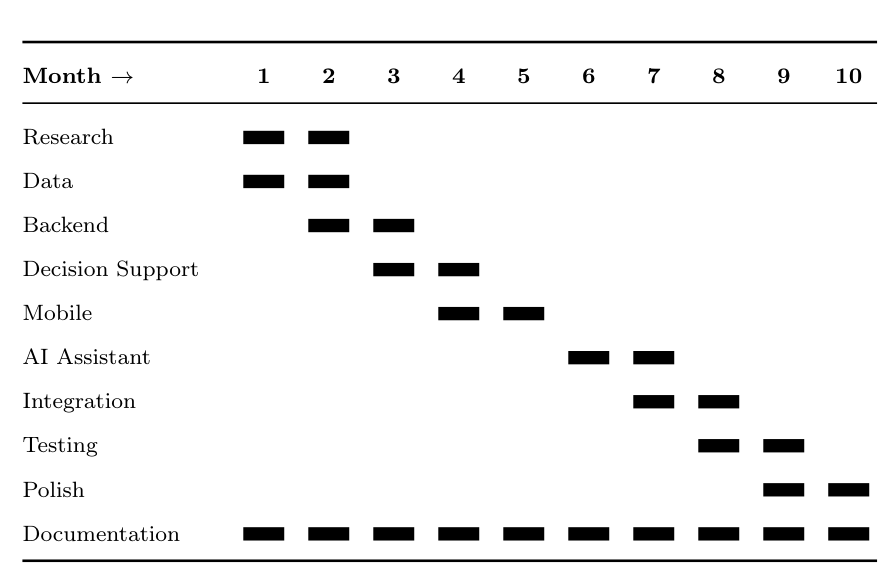

Figure 3.1: SafeBite Ten-Month Timeline

## 3.7. Feature-to-Requirement Traceability

**Table 33: Feature-to-Requirement Traceability Matrix**

| #   | Feature                                    | Requirement IDs     |
| --- | ------------------------------------------ | ------------------- |
| 0   | Global Rules (all features)                | GR-01 – GR-05       |
| 1   | Barcode Product Scanner                    | FR-01-01 – FR-01-07 |
| 2   | Product Search                             | FR-02-01 – FR-02-06 |
| 3   | Heavy-Metal and Contaminant Analysis       | FR-03-01 – FR-03-07 |
| 4   | Threshold and Margin Analysis              | FR-04-01 – FR-04-08 |
| 5   | Standardized Decision-Support Grading      | FR-05-01 – FR-05-05 |
| 6   | Cumulative Contamination Index             | FR-06-01 – FR-06-06 |
| 7   | Heavy-Metal Result Interpretation          | FR-07-01 – FR-07-07 |
| 8   | Evidence-Based Alternative Recommendations | FR-08-01 – FR-08-04 |
| 9   | Product Comparison                         | FR-09-01 – FR-09-04 |
| 10  | Evidence Level and Research Transparency   | FR-10-01 – FR-10-02 |
| 11  | AI Food Safety Assistant                   | FR-11-01 – FR-11-09 |
| 12  | Search and Scan History                    | FR-12-01 – FR-12-05 |
| 13  | Favorites and Watchlist                    | FR-13-01 – FR-13-07 |
| 14  | User Authentication and Profiles           | FR-14-01 – FR-14-06 |
| 15  | Offline Caching                            | FR-15-01 – FR-15-05 |
| 16  | Health-Context Interpretation              | FR-16-01 – FR-16-08 |
| 17  | Exposure-Reduction Guidance                | FR-17-01 – FR-17-04 |

## 3.8. Assumptions

The SafeBite requirements are based on the following assumptions:

1. Product information will be available for products supported by the system.

2. Research evidence will be available for at least some products, brands, or categories.

3. Evidence can be classified according to its relationship with a product.

4. Applicable reference limits can be associated with at least some validated contaminant measurements after evaluating food category, product matrix, jurisdiction, measurement basis, unit, standard version, and effective date.

5. Directly comparable product-specific evidence will be available for at least some product comparisons and alternative recommendations.

6. At least some contaminant records will contain sufficient measurement, unit, evidence-level, and reference metadata to support a plain-language result interpretation.

7. The selected implementation technologies will support the required barcode scanning and data processing functionality.

# 4. Use Case Models

## 4.1. Use Case Diagram

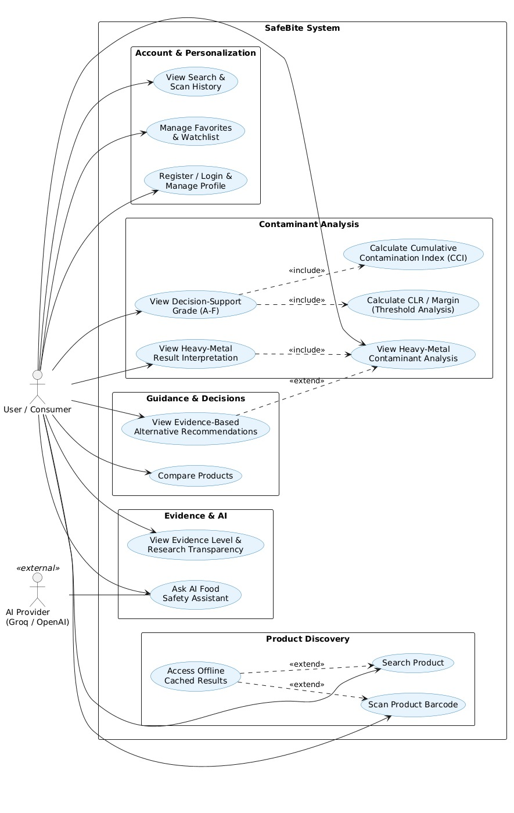

_Figure 4.1: SafeBite Use Case Diagram_

## 4.2. High-Level Use Cases

**Table 34: High-Level Use Cases**

| Use Case ID | Use Case                                      | Actor | Type       | Description                                                                                                            |
| ----------- | --------------------------------------------- | ----- | ---------- | ---------------------------------------------------------------------------------------------------------------------- |
| UC-01       | Scan Product                                  | User  | Primary    | Allows the user to scan a product barcode and retrieve the corresponding product information.                          |
| UC-02       | Search Product                                | User  | Primary    | Allows the user to find a product using its name, brand, category, or barcode.                                         |
| UC-03       | Analyze Contaminants                          | User  | Primary    | Retrieves available contaminant measurements and research evidence for a selected product.                             |
| UC-04       | View Threshold and Margin Analysis            | User  | Primary    | Compares reported contaminant concentrations with applicable reference limits using CLR and normalized margin.         |
| UC-05       | View Decision-Support Grade                   | User  | Supporting | Displays the optional A–F Decision-Support Grade when the required evidence and analysis rules are satisfied.          |
| UC-06       | View Cumulative Contamination Index           | User  | Primary    | Displays the CCI calculated from eligible contaminant CLR values.                                                      |
| UC-07       | View Result Interpretation                    | User  | Primary    | Presents the contaminant analysis and its limitations in plain language.                                               |
| UC-08       | View Alternative Products                     | User  | Supporting | Provides comparable alternative products when sufficient product-specific evidence is available.                       |
| UC-09       | Compare Products                              | User  | Primary    | Allows the user to compare the analysis results of two or more products.                                               |
| UC-10       | View Research Evidence                        | User  | Supporting | Allows the user to view evidence level, research metadata, and source information supporting an analysis.              |
| UC-11       | Ask AI Food Safety Assistant                  | User  | Primary    | Allows the user to ask food-safety questions and receive answers grounded in retrieved SafeBite evidence.              |
| UC-12       | View Search and Scan History                  | User  | Supporting | Allows the user to access previously searched and scanned products.                                                    |
| UC-13       | Manage Favorites and Watchlist                | User  | Supporting | Allows the user to save, view, and remove products from Favorites and Watchlist.                                       |
| UC-14       | Manage User Account                           | User  | Supporting | Allows the user to register, sign in, sign out, and manage supported profile information.                              |
| UC-15       | Access Cached Results Offline                 | User  | Supporting | Allows the user to view previously retrieved product results from the local cache when valid cached data is available. |
| UC-16       | Manage Health-Context Tags and Interpretation | User  | Supporting | Allows the user to consent to and manage optional tags, then view matching cited health-context evidence.              |
| UC-17       | View Exposure-Reduction Guidance              | User  | Supporting | Presents reviewed general guidance for eligible CLR statuses and explains when no conclusion is possible.              |

## 4.3. Expanded Use Cases

The following expanded use cases cover the core product-identification and deterministic-analysis workflow.

### 4.3.1. UC-01: Scan Product

**Table 35: Expanded Use Case UC-01: Scan Product**

| Field                | Specification                                                                                                                                                                                                                                                 |
| -------------------- | ------------------------------------------------------------------------------------------------------------------------------------------------------------------------------------------------------------------------------------------------------------- |
| Use Case ID          | UC-01                                                                                                                                                                                                                                                         |
| Use Case Name        | Scan Product                                                                                                                                                                                                                                                  |
| Actor                | User                                                                                                                                                                                                                                                          |
| Description          | Identifies a packaged-food product using its barcode.                                                                                                                                                                                                         |
| Priority             | High                                                                                                                                                                                                                                                          |
| Criticality          | Critical                                                                                                                                                                                                                                                      |
| Trigger Event        | The user opens the scanner and scans a barcode.                                                                                                                                                                                                               |
| Pre-Condition        | Camera permission is available and the barcode scanner is active.                                                                                                                                                                                             |
| Post-Condition       | Matched product information is displayed.                                                                                                                                                                                                                     |
| Main Scenario        | 1. The user opens the barcode scanner. 2. The user scans the product barcode. 3. The system decodes the EAN-13 or UPC-A value. 4. The system searches the product catalogue. 5. The matched product is displayed and made available for analysis. |
| Alternative Scenario | The user rescans the barcode or performs a manual product search when the barcode cannot be read.                                                                                                                                                             |
| Exceptional Scenario | The system displays “Product Not Found” when the decoded barcode matches no catalogue product.                                                                                                                                                                |
| Frequency of Use     | Frequent                                                                                                                                                                                                                                                      |
| Result               | The product is identified and ready for analysis.                                                                                                                                                                                                             |

### 4.3.2. UC-02: Search Product

**Table 36: Expanded Use Case UC-02: Search Product**

| Field                | Specification                                                                                                                                                                                                               |
| -------------------- | --------------------------------------------------------------------------------------------------------------------------------------------------------------------------------------------------------------------------- |
| Use Case ID          | UC-02                                                                                                                                                                                                                       |
| Use Case Name        | Search Product                                                                                                                                                                                                              |
| Actor                | User                                                                                                                                                                                                                        |
| Description          | Finds a product through text- or barcode-based search.                                                                                                                                                                      |
| Priority             | High                                                                                                                                                                                                                        |
| Criticality          | Critical                                                                                                                                                                                                                    |
| Trigger Event        | The user enters a product name, brand, category, or barcode.                                                                                                                                                                |
| Pre-Condition        | The product catalogue is accessible.                                                                                                                                                                                        |
| Post-Condition       | Matching products are displayed and the selected product is opened.                                                                                                                                                         |
| Main Scenario        | 1. The user enters a search query. 2. The system validates and submits the query. 3. The system searches the product catalogue. 4. Matching products are displayed. 5. The user selects a product for analysis. |
| Alternative Scenario | The user modifies the query, filters by brand or category, or searches by barcode.                                                                                                                                          |
| Exceptional Scenario | The system displays “Product Not Found” when the query matches no catalogue product.                                                                                                                                        |
| Frequency of Use     | Frequent                                                                                                                                                                                                                    |
| Result               | The selected product is opened for analysis.                                                                                                                                                                                |

### 4.3.3. UC-03: Analyze Contaminants

**Table 37: Expanded Use Case UC-03: Analyze Contaminants**

| Field                | Specification                                                                                                                                                                                                                                                                                                                                                                 |
| -------------------- | ----------------------------------------------------------------------------------------------------------------------------------------------------------------------------------------------------------------------------------------------------------------------------------------------------------------------------------------------------------------------------- |
| Use Case ID          | UC-03                                                                                                                                                                                                                                                                                                                                                                         |
| Use Case Name        | Analyze Contaminants                                                                                                                                                                                                                                                                                                                                                          |
| Actor                | User                                                                                                                                                                                                                                                                                                                                                                          |
| Description          | Retrieves available contaminant measurements and research evidence for a selected product.                                                                                                                                                                                                                                                                                    |
| Priority             | High                                                                                                                                                                                                                                                                                                                                                                          |
| Criticality          | Critical                                                                                                                                                                                                                                                                                                                                                                      |
| Trigger Event        | The user opens the analysis for an identified product.                                                                                                                                                                                                                                                                                                                        |
| Pre-Condition        | A product is identified and the evidence repository is accessible.                                                                                                                                                                                                                                                                                                            |
| Post-Condition       | Available contaminant findings, evidence levels, and sources are displayed.                                                                                                                                                                                                                                                                                                   |
| Main Scenario        | 1. The system retrieves evidence associated with the product. 2. The system identifies reported contaminant measurements. 3. Each measurement is validated and assigned an evidence level. 4. Product-specific evidence is marked as eligible or ineligible under the active rule set. 5. Available findings, missing data, and source information are displayed. |
| Alternative Scenario | Brand- or category-level evidence may be displayed as context but is excluded from product-level CLR, CCI, grade, and automatic recommendation calculations.                                                                                                                                                                                                                  |
| Exceptional Scenario | The system displays “Insufficient Data” with the applicable reason code when the available inputs cannot support product-level analysis.                                                                                                                                                                                                                                      |
| Frequency of Use     | Frequent                                                                                                                                                                                                                                                                                                                                                                      |
| Result               | Available contaminant evidence is presented transparently for the selected product.                                                                                                                                                                                                                                                                                           |

### 4.3.4. UC-04: View Threshold and Margin Analysis

**Table 38: Expanded Use Case UC-04: View Threshold and Margin Analysis**

| Field                | Specification                                                                                                                                                                                                                                                                                                                                    |
| -------------------- | ------------------------------------------------------------------------------------------------------------------------------------------------------------------------------------------------------------------------------------------------------------------------------------------------------------------------------------------------ |
| Use Case ID          | UC-04                                                                                                                                                                                                                                                                                                                                            |
| Use Case Name        | View Threshold and Margin Analysis                                                                                                                                                                                                                                                                                                               |
| Actor                | User                                                                                                                                                                                                                                                                                                                                             |
| Description          | Compares reported contaminant concentrations with applicable reference limits.                                                                                                                                                                                                                                                                   |
| Priority             | High                                                                                                                                                                                                                                                                                                                                             |
| Criticality          | Critical                                                                                                                                                                                                                                                                                                                                         |
| Trigger Event        | The user requests the contaminant analysis for a product.                                                                                                                                                                                                                                                                                        |
| Pre-Condition        | A validated concentration and a directly comparable reference limit are available.                                                                                                                                                                                                                                                               |
| Post-Condition       | CLR, normalized margin, selected reference, and comparison status are displayed.                                                                                                                                                                                                                                                                 |
| Main Scenario        | 1. The system determines the applicable product and standard category. 2. The system selects the applicable PSQCA limit or Codex fallback. 3. The system validates unit and measurement-basis comparability. 4. The system calculates CLR and normalized margin. 5. The system assigns and displays the applicable catalogue status. |
| Alternative Scenario | An applicable EU limit may be displayed separately as a labelled secondary comparison and shall not affect CCI or grading.                                                                                                                                                                                                                       |
| Exceptional Scenario | The system displays “Not Tested”, “No Applicable Limit Found”, or “Not Comparable” with the applicable reason code when a valid CLR cannot be produced.                                                                                                                                                                                          |
| Frequency of Use     | Frequent                                                                                                                                                                                                                                                                                                                                         |
| Result               | The user sees the contaminant-to-limit comparison and its limitations.                                                                                                                                                                                                                                                                           |

### 4.3.5. UC-06: View Cumulative Contamination Index

**Table 39: Expanded Use Case UC-06: View Cumulative Contamination Index**

| Field                | Specification                                                                                                                                                                                                                                                                                                                                                                          |
| -------------------- | -------------------------------------------------------------------------------------------------------------------------------------------------------------------------------------------------------------------------------------------------------------------------------------------------------------------------------------------------------------------------------------- |
| Use Case ID          | UC-06                                                                                                                                                                                                                                                                                                                                                                                  |
| Use Case Name        | View Cumulative Contamination Index                                                                                                                                                                                                                                                                                                                                                    |
| Actor                | User                                                                                                                                                                                                                                                                                                                                                                                   |
| Description          | Presents the arithmetic mean of eligible contaminant CLR values.                                                                                                                                                                                                                                                                                                                       |
| Priority             | High                                                                                                                                                                                                                                                                                                                                                                                   |
| Criticality          | Major                                                                                                                                                                                                                                                                                                                                                                                  |
| Trigger Event        | The user opens a product analysis.                                                                                                                                                                                                                                                                                                                                                     |
| Pre-Condition        | The minimum number of eligible contaminant measurements defined by the active rule set is available.                                                                                                                                                                                                                                                                                   |
| Post-Condition       | CCI, eligible contaminants, and excluded contaminants are displayed.                                                                                                                                                                                                                                                                                                                   |
| Main Scenario        | 1. The system identifies contaminant results with valid CLR values. 2. The system excludes missing, invalid, and non-comparable results. 3. The system verifies the minimum evidence and priority-metal rules. 4. The system calculates the arithmetic mean of eligible CLR values. 5. The system displays CCI, maximum CLR, included contaminants, and exclusion reasons. |
| Alternative Scenario | Individual contaminant results remain available when a CCI cannot be calculated.                                                                                                                                                                                                                                                                                                       |
| Exceptional Scenario | The system displays “Insufficient Data” with reason code `MIN_ELIGIBLE_NOT_MET` when the minimum eligibility requirement is not satisfied.                                                                                                                                                                                                                                             |
| Frequency of Use     | Frequent                                                                                                                                                                                                                                                                                                                                                                               |
| Result               | The user sees the cumulative comparison index and the evidence used in its calculation.                                                                                                                                                                                                                                                                                                |

### 4.3.6. UC-11: Ask AI Food Safety Assistant

**Table 40: Expanded Use Case UC-11: Ask AI Food Safety Assistant**

| Field                | Specification                                                                                                                                                                                                                                                                                                                                             |
| -------------------- | --------------------------------------------------------------------------------------------------------------------------------------------------------------------------------------------------------------------------------------------------------------------------------------------------------------------------------------------------------- |
| Use Case ID          | UC-11                                                                                                                                                                                                                                                                                                                                                     |
| Use Case Name        | Ask AI Food Safety Assistant                                                                                                                                                                                                                                                                                                                              |
| Actor                | User                                                                                                                                                                                                                                                                                                                                                      |
| Description          | Answers user questions using retrieved SafeBite evidence.                                                                                                                                                                                                                                                                                                 |
| Priority             | High                                                                                                                                                                                                                                                                                                                                                      |
| Criticality          | Major                                                                                                                                                                                                                                                                                                                                                     |
| Trigger Event        | The user submits a question to the AI assistant.                                                                                                                                                                                                                                                                                                          |
| Pre-Condition        | An internet connection and the AI service are available.                                                                                                                                                                                                                                                                                                  |
| Post-Condition       | A citation-grounded answer is returned.                                                                                                                                                                                                                                                                                                                   |
| Main Scenario        | 1. The user submits a food-safety question. 2. The system retrieves relevant SafeBite evidence and stored analysis results. 3. The assistant generates a response using only the retrieved evidence. 4. The system validates every citation against the retrieved records. 5. The citation-grounded answer and its limitations are displayed. |
| Alternative Scenario | The assistant asks the user to reformulate the question or provides a qualified, limited response when the retrieved evidence is weak.                                                                                                                                                                                                                    |
| Exceptional Scenario | The system displays “No Supporting Evidence Found” when no valid supporting evidence is retrieved, or “Assistant Unavailable” when the AI provider fails or times out.                                                                                                                                                                                    |
| Frequency of Use     | Frequent                                                                                                                                                                                                                                                                                                                                                  |
| Result               | The user receives an evidence-grounded response with validated citations.                                                                                                                                                                                                                                                                                 |

# 5. Structural Design Models

## 5.1. Domain Model

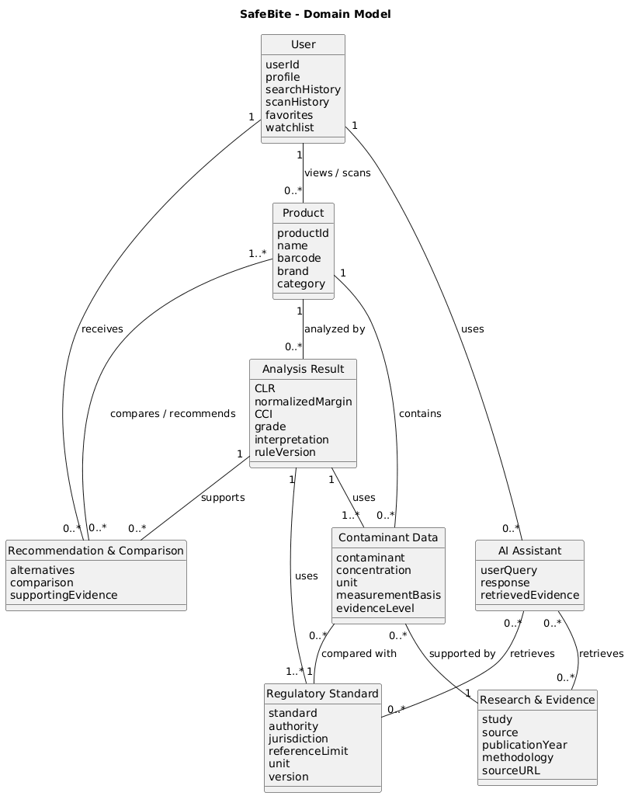

_Figure 5.1: SafeBite Domain Model_

## 5.2. Class Diagram

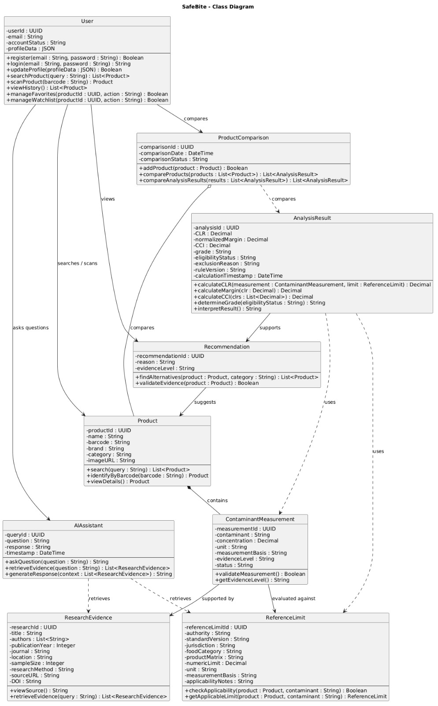

_Figure 5.2: SafeBite Class Diagram_

## 5.3. Layer Diagram

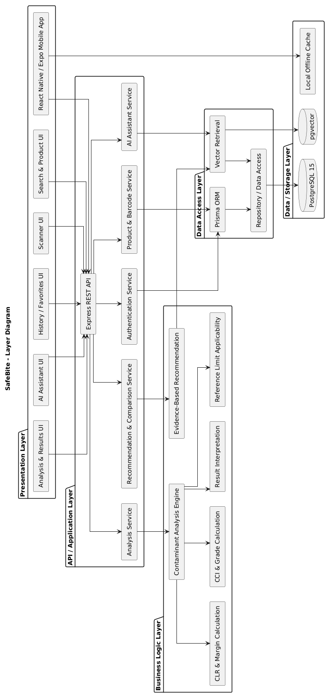

_Figure 5.3: SafeBite Layer Diagram_

# 6. Behavioral Design Models

## 6.1. Activity / Swimlane Diagram

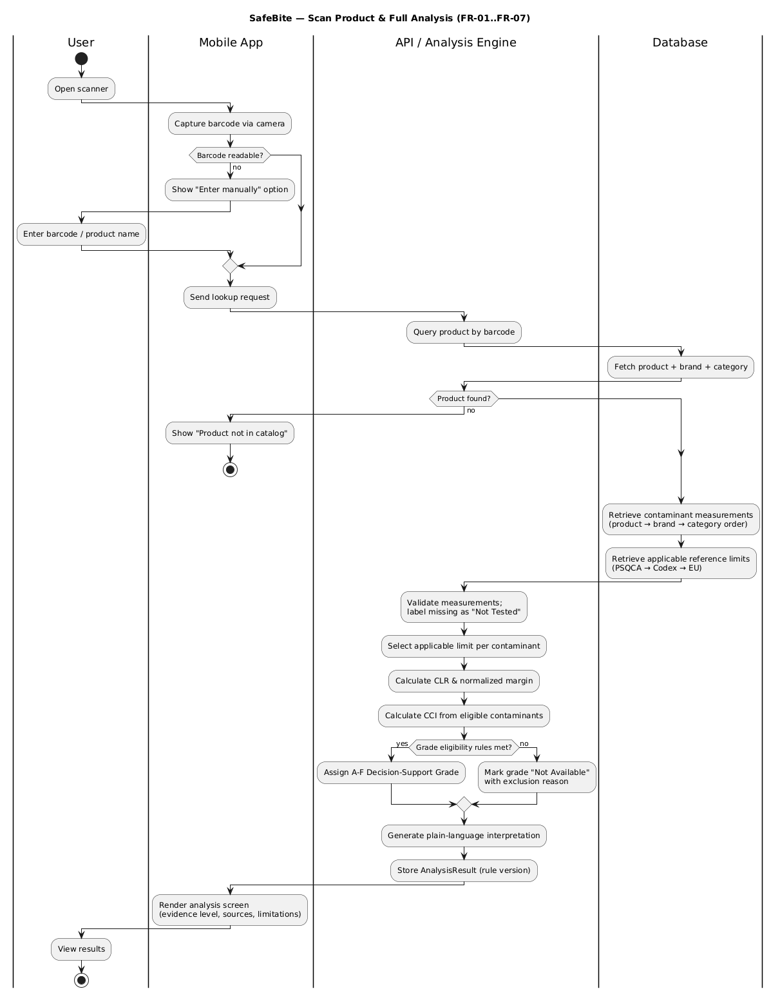

_Figure 6.1: Product Scan and Analysis Activity Diagram_

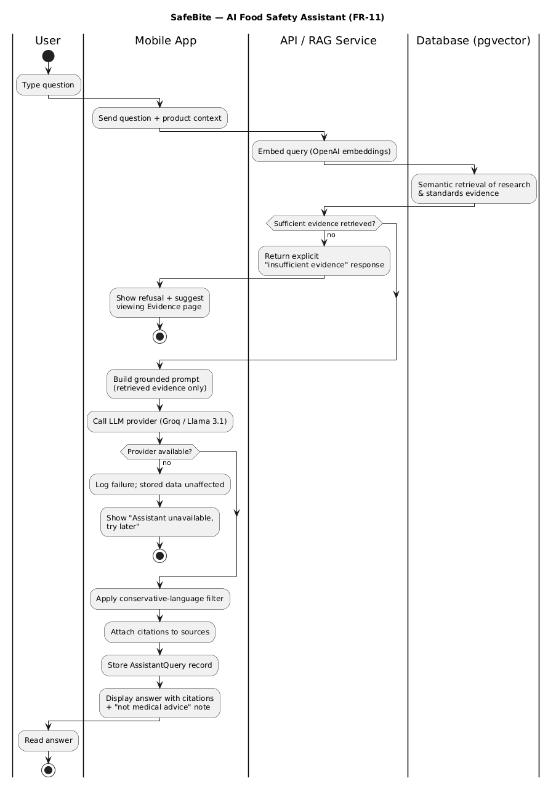

_Figure 6.2: AI Food Safety Assistant Activity Diagram_

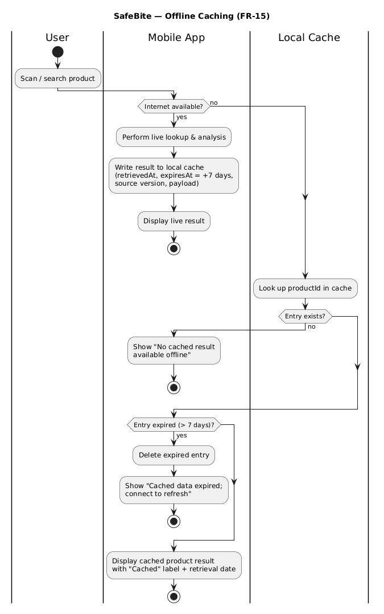

_Figure 6.3: Offline Caching Activity Diagram_

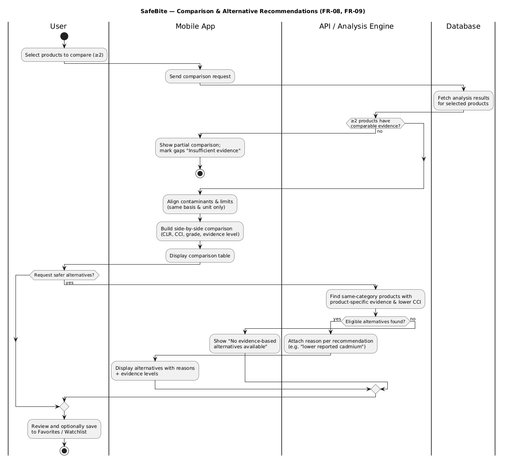

_Figure 6.4: Product Comparison and Alternative Recommendations Activity Diagram_

## 6.2. Flow Diagram

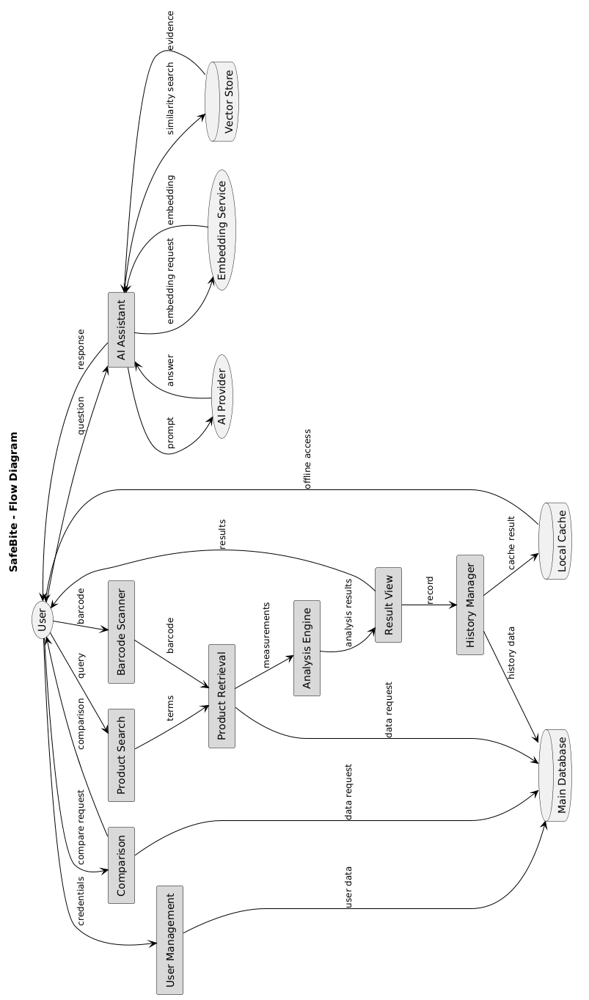

_Figure 6.5: SafeBite System Flow Diagram_

## 6.3. System Sequence Diagrams

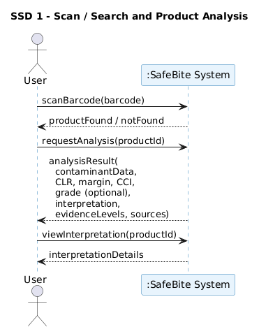

_Figure 6.6: SSD 1: Scan, Search, and Product Analysis_

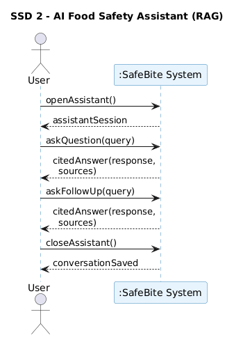

_Figure 6.7: SSD 2: AI Food Safety Assistant_

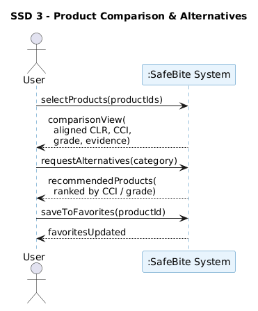

_Figure 6.8: SSD 3: Product Comparison and Alternatives_

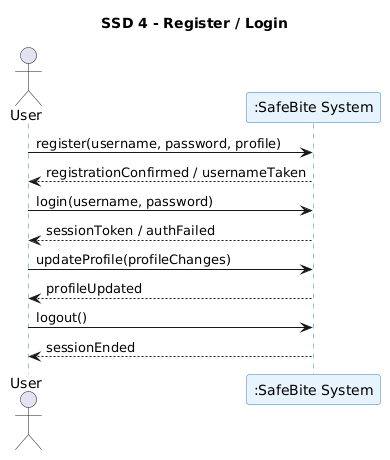

_Figure 6.9: SSD 4: User Registration and Login_

## 6.4. Data Flow Diagram (DFD)

### 6.4.1. Context Diagram (Level 0)

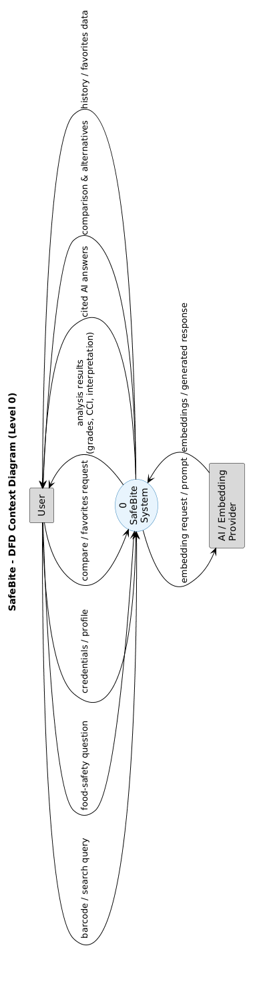

_Figure 6.10: SafeBite Context Diagram (DFD Level 0)_

### 6.4.2. Level 1 Data Flow Diagram

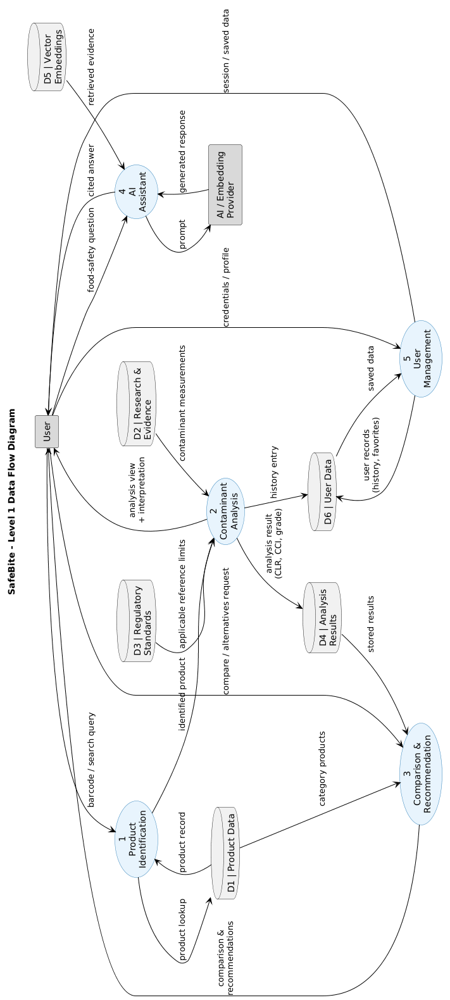

_Figure 6.11: SafeBite Data Flow Diagram (Level 1)_

# 7. Database Design Models

## 7.1. Entity Relationship Diagram

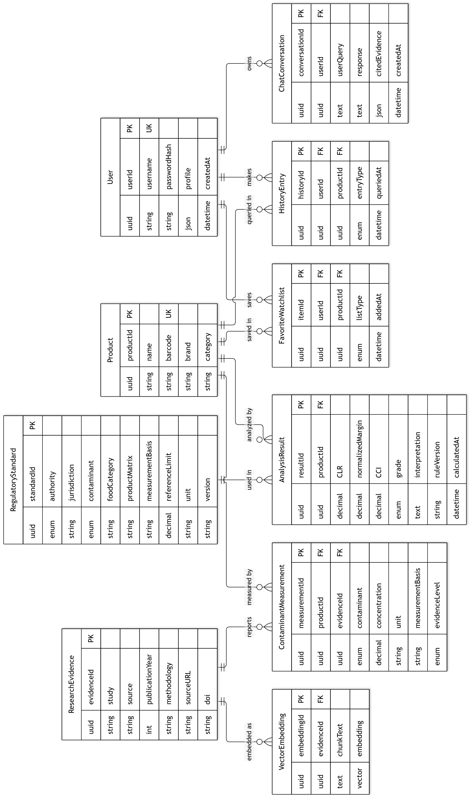

_Figure 7.1: SafeBite Entity Relationship Diagram_

# 8. Architecture and Deployment Models

## 8.1. Architecture Diagram

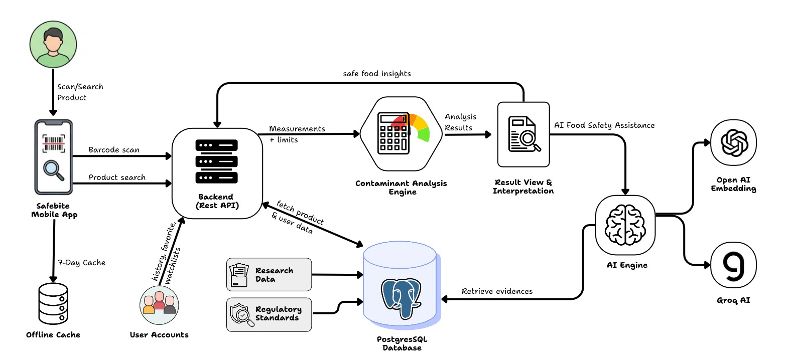

_Figure 8.1: SafeBite Architecture Diagram_

## 8.2. Deployment Diagram

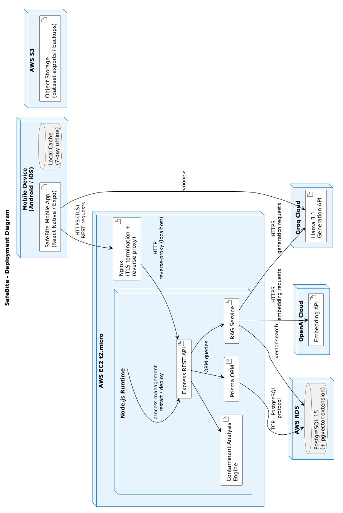

_Figure 8.2: SafeBite Deployment Diagram_

# 9. Conclusion

This Software Requirements Specification defines the requirements and scope of SafeBite, a mobile food-safety decision-support system focused on heavy-metal and other contaminant information in Pakistani packaged foods.

SafeBite is designed to identify products through barcode scanning and product search, retrieve available research evidence and applicable regulatory references, and compare validated contaminant measurements with directly comparable reference limits. The system defines Concentration-to-Limit Ratio (CLR) and Cumulative Contamination Index (CCI) calculations, together with evidence-level classification, missing-data handling, and plain-language interpretation of analysis results.

The SRS also defines supporting functionality for product comparison, evidence transparency, alternative-product recommendations, citation-grounded AI assistance, search and scan history, favorites and watchlists, authentication, and limited offline access. These requirements establish the functional behavior, data requirements, quality constraints, analysis rules, implementation environment, and design references needed for subsequent development and testing.

SafeBite does not perform laboratory testing, diagnose medical conditions, estimate individual dietary exposure, or guarantee the safety of a product. Its outputs are intended to present available contaminant evidence and regulatory comparisons in a transparent and understandable form.

This SRS serves as the baseline requirements document for the design, implementation, testing, and evaluation of the SafeBite Final Year Project.

# References

[1] UNICEF Pakistan and Ministry of National Health Services, Regulations and Coordination, “Lead Levels in Pakistan Pose Toxic Threat to Children,” May 1, 2026, https://www.unicef.org/pakistan/press-releases/lead-levels-pakistan-pose-toxic-threat-children.

[2] United Nations Department of Economic and Social Affairs, “Sustainable Development Goals: Goals 3, 9, and 12,” 2015.

[3] FAO/WHO Codex Alimentarius Commission, General Standard for Contaminants and Toxins in Food and Feed, CXS 193-1995, last amended 2025, https://www.fao.org/fao-who-codexalimentarius/codex-texts/standards/en/.

[4] European Commission, Commission Regulation (EU) 2023/915 of 25 April 2023 on Maximum Levels for Certain Contaminants in Food and Repealing Regulation (EC) No. 1881/2006, consolidated version of August 19, 2026, https://eur-lex.europa.eu/legal-content/EN/TXT/?uri=CELEX:02023R0915-20260819.

[5] Pakistan Standards and Quality Control Authority, “Pakistan Food Standards,” https://www.psqca.com.pk/.

[6] Pakistan Standards and Quality Control Authority, Pakistan Standard Specification for Packaged Liquid Milk, PS: 5344-2022, 2022, https://psqca.com.pk/cs/AGRICULTURE%20AND%20FOOD%20-%2043/PS%205344-2016%20for%20Packaged%20Liquid%20Milk%20%202016.%20-%20Copy.pdf.

[7] Pakistan Standards and Quality Control Authority, Pakistan Standard Specification for Bottled Natural Mineral Waters, PS: 2102-2010, 2010, https://psqca.com.pk/cs/AGRICULTURE%20AND%20FOOD%20-%2043/PS%202102-2010%20for%20Bottled%20NATURAL%20MINERAL%20WATER%20FINAL%20%20-%20Copy.pdf.

[8] WaleedBSCS, Heavy Metal Contamination Dataset Pakistan, Kaggle, https://www.kaggle.com/datasets/waleedbscs/heavy-metal-contamination-dataset-pakistan, September 30, 2026.

[9] V. Kharkwal, M. Choudhary, K. Bains, and M. Bishnoi, “Non-carcinogenic and Carcinogenic Health Risk Assessment of Heavy Metals in Cooked Beans and Vegetables in Punjab, North India,” Food Science & Nutrition, vol. 11, no. 12, pp. 7581–7593, 2023, doi: 10.1002/fsn3.3678.

[10] H. Abbasi, M. H. Shah, M. Mohiuddin, M. S. Elshikh, Z. Hussain, J. Alkahtani, W. Ullah, M. S. Alwahibi, and A. M. Abbasi, “Quantification of Heavy Metals and Health Risk Assessment in Processed Fruits’ Products,” Arabian Journal of Chemistry, vol. 13, no. 12, pp. 8965–8978, 2020, doi: 10.1016/j.arabjc.2020.10.020.

[11] A. H. Shah, Salah-ud-Din, F. R. Shah, and H. H. Khan, “Heavy Metal Contamination of Commercially Produced Breads,” Pakistan Journal of Scientific and Industrial Research, vol. 32, no. 7, pp. 483–484, 1989, https://pjsir.org/multidisciplinary-archive/Volume%2032%201989/Issue%207/Article%2013%20Vol%2032%20Issue%207%201989.pdf.

[12] M. Idrees, “Analysis and Human Health Risk from Selected Heavy Metals in Common Instant Noodles,” Biological Trace Element Research, vol. 198, no. 1, pp. 339–343, 2020, doi: 10.1007/s12011-020-02062-6, PMID: 32100272.

[13] M. Amjad, S. Hussain, Z. U. R. Baloch, and A. Raza, “Determination of Heavy Metals in Locally Available Chocolates in Lahore Region,” Turkish Journal of Agriculture–Food Science and Technology, vol. 9, no. 6, pp. 1144–1153, 2021, doi: 10.24925/turjaf.v9i6.1144-1153.4262.

[14] H. Anwar, S. Iqbal, A. Sajjad, H. Ullah, A. Farooqi, and B. Asif, “Health Risk Assessment of Heavy Metals in Raw and Packed Milk from the Areas of Rawalpindi and Islamabad: A Comparative Study,” Pak-Euro Journal of Medical and Life Sciences, vol. 5, no. 2, pp. 383– 390, 2022, doi: 10.31580/pjmls.v5i2.2580.

[15] M. Salman, R. Rehman, U. Shafique, and A. Abbas, “Toxic and Nutritive Elements Analysis of Commercially Available Tea Samples of Pakistan by ICP-OES Employing Microwave Digestion,” Electronic Journal of Environmental, Agricultural and Food Chemistry, vol. 11, no. 5, pp. 459–468, 2012.

[16] OpenAI, “Vector Embeddings,” accessed October 1, 2026, https://developers.openai.com/api/docs/guides/embeddings.

[17] Node.js, “Node.js Releases,” accessed October 1, 2026, https://nodejs.org/en/about/previous-releases.
