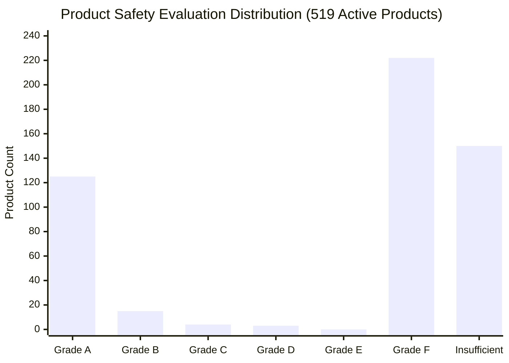

# SafeBite Food Safety Intelligence Platform
## Comprehensive Product Catalog & Chemical Contaminant Breakdown

**Document Version:** 2.2.0 (Post-`Product_Variants` GTIN Ingestion, Deduplication & Remediation)  
**Updated:** November 18, 2026  
**System Architecture:** SafeBite Backend Intelligence Core  
**Database Engine:** PostgreSQL 15 + `pgvector` (0.8.0) | Prisma ORM 6.4.0  
**Standards Regulatory Baseline:** PSQCA (Primary National), Codex Alimentarius (CXS 193-1995), European Commission (EU 2023/915)  
**Companion Reports:** [BARCODE_COVERAGE_AND_BULK_ANALYSIS.md](file:///d:/Desktop%20Folders/Run%20Codes/SafeBite-Backend/BARCODE_COVERAGE_AND_BULK_ANALYSIS.md) | [MIN_ELIGIBLE_NOT_MET_ANALYSIS.md](file:///d:/Desktop%20Folders/Run%20Codes/SafeBite-Backend/MIN_ELIGIBLE_NOT_MET_ANALYSIS.md) | [SafeBite_Missing_Barcodes_Commercial_SKUs.xlsx](file:///d:/Desktop%20Folders/Run%20Codes/SafeBite-Backend/SafeBite_Missing_Barcodes_Commercial_SKUs.xlsx)

---

## 1. Executive Summary & Inventory Metrics

The SafeBite platform ingests, harmonizes, and evaluates toxicological heavy metal contamination data for food products marketed and consumed across Pakistan. The system links empirical laboratory observations from peer-reviewed scientific literature to physical retail stock keeping units (SKUs), national and international regulatory standards, and precomputed deterministic consumer safety grades (`ruleVersion = "1.0.0"`).

Following the v2.1.0 catalog remediation (merging 8 exact/spelling duplicate SKUs, purging 22 zero-data academic placeholders, introducing `ProductType` & `isConsumerFacing`, and adding EU `2023/915` Cadmium MLs) and the **v2.2.0 `Product_Variants` GTIN expansion** (ingesting **86** GS1-validated barcodes across **48** previously unbarcoded commercial SKUs and reassigning **5** hijacked `MILK-006` collisions), **30/30 E2E API regression tests pass** with **100.00%** GS1 Modulo-10 barcode integrity.

### Core Inventory Metrics (Live PostgreSQL Snapshot — 2026-11-18)

| Data Dimension | Total Count | Unit / Resolution | Data Integrity Status |
|---|---:|---|---|
| **Total Active Food Products** | **519** | **302** Consumer-Facing (58.19%) / **217** Hidden Benchmarks (41.81%) | 100% Normalized, Deduplicated & Persisted |
| **Commercial Packaged SKUs** | **204** | `COMMERCIAL_PACKAGED` (`isConsumerFacing = true`) | **135** Barcoded (**66.18%**) / **69** Unbarcoded (33.82%) |
| **Retail Barcode Linkages** | **848** | `811` EAN-13, `19` UPC-A, `17` EAN-8, `1` GTIN-14 | **848 / 848 (100.00%)** GS1 Modulo-10 Valid; **209** Leading-Zero Preserved |
| **Chemical Heavy Metal Measurements** | **1,693** | ICP-OES & AAS Laboratory Observations | Quantitative ($\text{mg/kg}$, $\text{mg/L}$); 0 Zero-Data Products |
| **Food Categories** | **21** | **18** Populated + **3** Standards-Ready Empty Categories | 100% Classified |
| **Peer-Reviewed Literature Sources** | **38** | Academic & Scientific Studies | Peer-reviewed (2004–2024) |
| **Regulatory Reference Standards** | **192** | `179` PSQCA + `7` Codex + `6` EU Maximum Limits | Hierarchical Resolution Active |
| **Precomputed Deterministic Analyses** | **519** | Versioned Engine (`ruleVersion = "1.0.0"`) | **369** Graded (**71.10%**) / **150** `MIN_ELIGIBLE_NOT_MET` / **0** `NO_RESEARCH_RECORD` |
| **Consumer-Facing Graded Coverage** | **259 / 302** | `COMMERCIAL_PACKAGED` + `INFORMAL_WRAPPED` + `LOOSE_COMMODITY` | **85.76%** Graded (**82.35%** of Commercial SKUs) |

---

## 2. Category-by-Category Data Matrix

The **519** active catalog products span **18 populated** categories within the **21-category** taxonomy (3 additional categories — *Bottled Natural Mineral Water*, *Dairy - Yogurt & Butter*, and *Seafood & Fish* — carry active regulatory reference standards ready for future laboratory literature ingestion).

| Category Name | Total Products | Consumer-Facing | Commercial SKUs | Graded | Insufficient Data | Safety Grades (A / B / C / D / F) | Regulatory Standards | Chemical Measurements | Barcoded SKUs (Total GTINs) | Matrix Breakdown |
|---|---:|---:|---:|---:|---:|---|---:|---:|---:|---|
| **Biscuits & Cookies** | 13 | 0 | 0 | 0 | 13 | A:0 / B:0 / C:0 / D:0 / F:0 | 2 | 15 | 0 (0) | Solid: 13 |
| **Bottled Natural Mineral Water** | 0 | 0 | 0 | 0 | 0 | A:0 / B:0 / C:0 / D:0 / F:0 | 6 | 0 | 0 (0) | — |
| **Canned Vegetables & Pickles** | 82 | 11 | 9 | 36 | 46 | A:0 / B:0 / C:0 / D:0 / F:36 | 16 | 241 | **6** (13) | Solid: 80, Bulk: 2 |
| **Carbonated Beverages & Juices** | 74 | 33 | 31 | 45 | 29 | A:8 / B:5 / C:0 / D:0 / F:32 | 23 | 224 | **21** (40) | Liq: 41, Solid: 31, Bulk: 2 |
| **Chocolates & Confectionery** | 43 | 40 | 3 | 43 | 0 | A:0 / B:0 / C:0 / D:0 / F:43 | 4 | 145 | **2** (30) | Inf. Wrapped: 27, Solid: 16 |
| **Commercial Bread & Bakery** | 10 | 10 | 10 | 10 | 0 | A:10 / B:0 / C:0 / D:0 / F:0 | 2 | 30 | **4** (26) | Solid: 10 |
| **Dairy - Yogurt & Butter** | 0 | 0 | 0 | 0 | 0 | A:0 / B:0 / C:0 / D:0 / F:0 | 11 | 0 | 0 (0) | — |
| **Edible Oils & Ghee** | 8 | 7 | 0 | 3 | 5 | A:0 / B:0 / C:0 / D:0 / F:3 | 37 | 23 | 0 (0) | Solid: 8 |
| **Honey & Sweeteners** | 26 | 26 | 11 | 26 | 0 | A:26 / B:0 / C:0 / D:0 / F:0 | 3 | 131 | **3** (5) | Solid: 19, Bulk: 7 |
| **Infant Formula & Baby Foods** | 27 | 27 | 27 | 22 | 5 | A:21 / B:0 / C:0 / D:0 / F:1 | 4 | 59 | **26** (196) | Solid: 27 |
| **Instant Noodles** | 6 | 6 | 6 | 6 | 0 | A:0 / B:3 / C:0 / D:1 / F:2 | 2 | 24 | **6** (139) | Solid: 6 |
| **Packaged Liquid Milk** | 27 | 12 | 12 | 15 | 12 | A:7 / B:4 / C:3 / D:1 / F:0 | 12 | 68 | **9** (91) | Liq: 15, Solid: 12 |
| **Packaged Tea & Coffee** | 55 | 30 | 19 | 51 | 4 | A:43 / B:1 / C:0 / D:0 / F:7 | 2 | 225 | **14** (107) | Solid: 44, Bulk: 11 |
| **Poultry & Meat Products** | 26 | 0 | 0 | 1 | 25 | A:0 / B:0 / C:0 / D:0 / F:1 | 9 | 97 | 0 (0) | Solid: 26 |
| **Processed Fruit & Sauces** | 67 | 67 | 64 | 59 | 8 | A:0 / B:0 / C:0 / D:0 / F:59 | 15 | 183 | **36** (64) | Solid: 64, Bulk: 3 |
| **Pulses & Lentils** | 13 | 13 | 0 | 13 | 0 | A:0 / B:0 / C:0 / D:0 / F:13 | 4 | 65 | 0 (0) | Solid: 13 |
| **Rice & Basmati Grains** | 7 | 1 | 0 | 6 | 1 | A:0 / B:0 / C:0 / D:0 / F:6 | 1 | 23 | 0 (0) | Solid: 7 |
| **Seafood & Fish** | 0 | 0 | 0 | 0 | 0 | A:0 / B:0 / C:0 / D:0 / F:0 | 14 | 0 | 0 (0) | — |
| **Snack Foods & Chips** | 12 | 12 | 12 | 12 | 0 | A:0 / B:0 / C:1 / D:0 / F:11 | 2 | 48 | **8** (137) | Solid: 12 |
| **Spices & Condiments** | 19 | 3 | 0 | 17 | 2 | A:10 / B:2 / C:0 / D:1 / F:4 | 20 | 72 | 0 (0) | Solid: 19 |
| **Wheat Flour & Atta** | 4 | 4 | 0 | 4 | 0 | A:0 / B:0 / C:0 / D:0 / F:4 | 3 | 20 | 0 (0) | Solid: 4 |
| **Total / Summary** | **519** | **302** | **204** | **369** | **150** | **A:125 / B:15 / C:4 / D:3 / F:222** | **192** | **1,693** | **135 (848)** | **Solid: 411, Liq: 56, Inf.W: 27, Bulk: 25** |

---

## 3. Product Taxonomy & Brand Market Segments

The **519** active products are strictly segmented via the `ProductType` enum and `isConsumerFacing` flag:

| `ProductType` | `isConsumerFacing` | Total Products | Share of DB | Barcoded SKUs | Graded (%) | Role in Consumer API |
|---|---|---:|---:|---:|---:|---|
| **`COMMERCIAL_PACKAGED`** | `true` | **204** | 39.31% | **135** (66.18%) | **168** (82.35%) | Default consumer catalog & barcode scanner targets |
| **`INFORMAL_WRAPPED`** | `true` | **27** | 5.20% | 0 (0.00%) | **27** (100.00%) | Cottage-industry wrapped school candies; wrapper-name / semantic search |
| **`LOOSE_COMMODITY`** | `true` | **71** | 13.68% | 0 (0.00%) | **64** (90.14%) | Open-market loose teas, floral honeys, pulses, mithai, oils & staples |
| **`RESEARCH_BENCHMARK`** | `false` | **217** | 41.81% | 0 (0.00%) | **110** (50.69%) | Hidden from default `/api/products` & `/api/alternatives` (`?includeBenchmarks=true`) |
| **Total Active Catalog** | — | **519** | **100.00%** | **135** (26.01%) | **369** (71.10%) | — |

### Top Commercial Packaged Brands (Live PostgreSQL Counts)

| Brand Name | Commercial SKUs | Barcoded SKUs | Total GTINs | Primary Product Lines | Grade Breakdown |
|---|---:|---:|---:|---|---|
| **Nestle** | 17 | **17 / 17** (100%) | 155 | Cerelac, NAN/Lactogen Formula, MilkPak, Everyday, Nesvita | A: 12 / Ungraded: 5 |
| **Mitchell's** | 15 | **13 / 15** (86.7%) | 21 | Jams, Pickles, Canned Fruit, Ketchup, Marmalade, Sauces | F: 11 / Ungraded: 4 |
| **National** | 13 | **10 / 13** (76.9%) | 17 | Jams, Marmalades, Sauces, Pickles, Ketchup | F: 11 / Ungraded: 2 |
| **Shezan** | 13 | **9 / 13** (69.2%) | 15 | Juices, Jams, Pickles, Ketchup, Sauces, Bread | F: 10 / A: 1 / Ungraded: 2 |
| **Fruitien** | 8 | **6 / 8** (75.0%) | 9 | Packaged Nectars & Juices (Mango, Guava, Apple, Peach, etc.) | F: 4 / B: 1 / Ungraded: 3 |
| **Fruitavitals** | 6 | **6 / 6** (100%) | 20 | Premium Juices (Mango, Guava, Red Grapes, Peach, Kinnow, Apple) | F: 5 / Ungraded: 1 |
| **Salman's** | 5 | **5 / 5** (100%) | 5 | Jams & Citrus Marmalades | F: 5 |
| **Tops** | 5 | **1 / 5** (20.0%) | 1 | Ready-to-Drink Fruit Beverages (Frootopia / Pouch / Tetra) | F: 5 |
| **Fruit Tree** | 5 | **0 / 5** (0.0%) | 0 | Commercial Preserves & Jams | F: 5 |
| **Tapal** | 4 | **4 / 4** (100%) | 13 | Packaged Black & Green Teas (Family Mixture, Tezdum, Danedar) | A: 4 |
| **Shangrilla** | 4 | **3 / 4** (75.0%) | 8 | Pickles, Mixed Achar, Sauces | F: 3 / Ungraded: 1 |
| **California** | 4 | **2 / 4** (50.0%) | 9 | Canned Peach, Pineapple & Pear Halves | F: 4 |
| **Knorr** | 3 | **3 / 3** (100%) | 43 | Instant Noodles, Tomato Ketchup, Chilli Garlic Sauce | F: 2 / B: 1 |
| **GSK (Horlicks)** | 3 | **3 / 3** (100%) | 23 | Malt & Nutritional Drinks (Wheat, Chocolate, Junior) | A: 3 |
| **Complan** | 3 | **3 / 3** (100%) | 21 | Nutritional Powder Supplements (Vanilla, Chocolate, Strawberry) | A: 2 / F: 1 |
| **Haleeb** | 3 | **2 / 3** (66.7%) | 6 | Liquid Milk & Packaged Juices | F: 1 / Ungraded: 2 |
| **Engro Foods** | 3 | **2 / 3** (66.7%) | 5 | Olper's, Dairy Omung, Tarang Tea Whitener | Ungraded: 3 |
| **Italia** | 3 | **1 / 3** (33.3%) | 1 | Canned Fruit Cocktails & Strawberries | F: 3 |
| **Islamic** | 3 | **0 / 3** (0.0%) | 0 | Packaged Natural Honeys | A: 3 |
| **Kinza** | 3 | **0 / 3** (0.0%) | 0 | Ketchup & Savory Table Sauces | F: 3 |

### Non-Packaged Consumer Segments & Academic Benchmarks (315 Products)
- **27 `INFORMAL_WRAPPED` School-Zone Confectionery Items (`CHOC-001`..`CHOC-030` excl. `003`, `004`, `029`):** Individually wrapped Rs. 5–20 cottage-industry candies collected outside urban school zones; **100% (27/27) graded F** due to elevated Lead and Cadmium.
- **71 `LOOSE_COMMODITY` Consumer Staples:** **15** floral/regional honeys (100% Grade A), **13** pulses & lentils (100% Grade F), **11** loose bazaar teas (100% graded), **10** traditional mithai, **7** loose edible oils, **4** wheat flours, **3** loose condiments/salts, **3** open fruit sauces, **2** loose pickles, **2** loose beverages, **1** loose rice.
- **217 `RESEARCH_BENCHMARK` Academic Reference Samples:** Blinded laboratory codes (`RSK-*`, `TEA2`/`TEA3`, `BEV-*`), raw agricultural/slaughterhouse matrices (`SND-*`, `VEG-*`), and pooled statistical aggregates hidden from the default consumer API.

---

## 4. Heavy Metal Laboratory Observations & Toxicological Metrics

A total of **1,693 chemical measurements** are persisted across **38 peer-reviewed scientific publications** (ICP-OES and AAS quantification): **408** Lead (`Pb`), **382** Cadmium (`Cd`), **349** Chromium (`Cr`), **313** Copper (`Cu`), and **241** Cobalt (`Co`).

### Quantified Contaminant Summary (Non-Null Numeric Concentrations)

| Contaminant | Quantified Observations | Unit & Basis | Minimum Observed | Maximum Observed | Empirical Mean ($\mu$) | Standard Deviation ($\sigma$) |
|---|---:|---|---:|---:|---:|---:|
| **Lead ($\text{Pb}$)** | 349 | $\text{mg/kg}$ (mass) | `0.00011` | `26.160` | **`2.387 mg/kg`** | `±4.282` |
| **Lead ($\text{Pb}$)** | 48 | $\text{mg/L}$ (volume) | `0.00200` | `11.710` | **`1.213 mg/L`** | `±2.787` |
| **Cadmium ($\text{Cd}$)** | 345 | $\text{mg/kg}$ (mass) | `0.00011` | `74.730` | **`2.040 mg/kg`** | `±6.543` |
| **Cadmium ($\text{Cd}$)** | 27 | $\text{mg/L}$ (volume) | `0.00100` | `0.678` | **`0.109 mg/L`** | `±0.171` |
| **Chromium ($\text{Cr}$)** | 278 | $\text{mg/kg}$ (mass) | `0.00500` | `34.960` | **`2.870 mg/kg`** | `±3.978` |
| **Chromium ($\text{Cr}$)** | 35 | $\text{mg/L}$ (volume) | `0.00100` | `21.380` | **`2.396 mg/L`** | `±6.559` |
| **Copper ($\text{Cu}$)** | 277 | $\text{mg/kg}$ (mass) | `0.00012` | `21.600` | **`2.684 mg/kg`** | `±4.478` |
| **Copper ($\text{Cu}$)** | 36 | $\text{mg/L}$ (volume) | `0.00700` | `95.000` | **`7.004 mg/L`** | `±18.193` |
| **Cobalt ($\text{Co}$)** | 208 | $\text{mg/kg}$ (mass) | `0.00013` | `48.420` | **`2.405 mg/kg`** | `±5.204` |
| **Cobalt ($\text{Co}$)** | 17 | $\text{mg/L}$ (volume) | `0.02400` | `0.0503` | **`0.045 mg/L`** | `±0.006` |

*(An additional **73** observations across the 5 metals are recorded as `BELOW_LOD` non-detects without a positive numeric point concentration, bringing the grand total to exactly **1,693** `research_data` rows.)*

### Data Quality & Evidence Lineage Distribution (1,693 Observations)

| Dimension | Category | Record Count | Share | Engine Handling |
|---|---|---:|---:|---|
| **Measurement Status** | `MEASURED` | **1,607** | 94.92% | Exact quantitative concentration evaluated against regulatory ML |
| **Measurement Status** | `BELOW_LOD` | **73** | 4.31% | Non-detect; treated as compliant ($CLR = 0$, eligible toward $k \ge 2$) |
| **Measurement Status** | `RANGE_VALUE` | **13** | 0.77% | Interval range (`range_max`); strictly excluded from numeric CCI averaging |
| **Evidence Level** | `BRAND_LEVEL` | **941** | 55.58% | Eligible for commercial brand/SKU deterministic grading |
| **Evidence Level** | `PRODUCT_SPECIFIC` | **418** | 24.69% | Highest-precision direct SKU laboratory observation |
| **Evidence Level** | `CATEGORY_LEVEL` | **334** | 19.73% | Strictly excluded from individual product grading per `FR-03-07` |

---

## 5. Precomputed Safety Evaluations & Risk Grading (`ruleVersion = "1.0.0"`)

SafeBite's deterministic safety engine computes Contaminant-to-Limit Ratios ($CLR_i = \text{Concentration}_i / \text{ML}_i$) and enforces a minimum of $k \ge 2$ eligible regulated metals (`FR-06-06`).

### Platform Grading Scale & Segment Distribution

| Safety Grade | CLR / CCI Threshold | All Products (519) | Consumer-Facing (302) | Commercial Packaged (204) | Barcoded Commercial (135) |
|---|---|---:|---:|---:|---:|
| **Grade A** | Superior Safety ($CLR_{\max} \le 0.50$) | **125** (24.08%) | **86** (28.48%) | **61** (29.90%) | **41** (30.37%) |
| **Grade B** | Good Safety ($0.50 < CLR_{\max} \le 0.75$) | **15** (2.89%) | **4** (1.32%) | **4** (1.96%) | **4** (2.96%) |
| **Grade C** | Moderate Safety ($0.75 < CLR_{\max} \le 1.00$) | **4** (0.77%) | **1** (0.33%) | **1** (0.49%) | **0** (0.00%) |
| **Grade D** | Marginal Exceedance ($1.00 < CLR_{\max} \le 1.25$) | **3** (0.58%) | **1** (0.33%) | **1** (0.49%) | **1** (0.74%) |
| **Grade E** | Elevated Exceedance | **0** (0.00%) | **0** (0.00%) | **0** (0.00%) | **0** (0.00%) |
| **Grade F** | Severe Violation ($CLR_{\max} > 1.25$) | **222** (42.77%) | **167** (55.30%) | **101** (49.51%) | **66** (48.89%) |
| **Insufficient Data** | `MIN_ELIGIBLE_NOT_MET` (`k < 2`) | **150** (28.90%) | **43** (14.24%) | **36** (17.65%) | **23** (17.04%) |
| **Total Graded (%)** | — | **369 (71.10%)** | **259 (85.76%)** | **168 (82.35%)** | **112 (82.96%)** |

### Primary Chemical Drivers of Grade F Violations (222 Total / 167 Consumer-Facing)

| Primary Contaminant Driver | All Grade F Products (222) | Share (All) | Consumer-Facing Grade F (167) | Share (Consumer) | Principal Affected Categories |
|---|---:|---:|---:|---:|---|
| **Lead ($\text{Pb}$)** | **127** | 57.21% | **105** | 62.87% | Fruit preserves, pickles, confectionery, juices, pulses, snacks, spices |
| **Cadmium ($\text{Cd}$)** | **77** | 34.68% | **50** | 29.94% | Jams/sauces (EU 0.05 mg/kg ML), school chocolates, rice, wheat flour |
| **Copper ($\text{Cu}$)** | **18** | 8.11% | **12** | 7.19% | Canned fruit cocktails, processed sauces, ketchup |

### Insufficient Data Root Cause Summary (150 Products; Zero `NO_RESEARCH_RECORD`)
1. **`UNREGULATED_METALS_ONLY` (`58` total — `12` consumer / `46` benchmark / `6` barcoded):** Source studies measured only unregulated metals (`Cr`, `Co`, or `Cu`) where no statutory PSQCA/Codex/EU limit exists.
2. **`SINGLE_ELIGIBLE_METAL` (`47` total — `26` consumer / `21` benchmark / `17` barcoded):** Valid CLR computed for exactly 1 metal (`Cd`, `Cu`, or `Pb`), requiring a second regulated metal (`k >= 2`).
3. **`CATEGORY_LEVEL_ONLY` (`45` total — `5` consumer / `40` benchmark / `0` barcoded):** Composite category-level studies excluded from product-level grading by `FR-03-07`.

*(See [MIN_ELIGIBLE_NOT_MET_ANALYSIS.md](file:///d:/Desktop%20Folders/Run%20Codes/SafeBite-Backend/MIN_ELIGIBLE_NOT_MET_ANALYSIS.md) for the complete SKU-level audit of all 43 remaining consumer-facing ungraded products.)*

---

## 6. Regulatory Standards Harmonization Matrix (192 Active Standards)

SafeBite enforces a deterministic 3-tier hierarchy via [standard-resolver.service.ts](file:///d:/Desktop%20Folders/Run%20Codes/SafeBite-Backend/src/services/standard-resolver.service.ts): **PSQCA** (Primary National) $\rightarrow$ **Codex Alimentarius** (`CXS 193-1995`) $\rightarrow$ **European Commission** (`EU 2023/915`).

| Issuing Authority | Reference Role | Active Standards | Targeted Contaminants | Key Standard References |
|---|---|---:|---|---|
| **PSQCA** | `PRIMARY_NATIONAL` | **124** | $\text{Pb}, \text{Cd}, \text{Cu}, \text{Cr}$ | PS 2102-2010, PS 1823, PS 470, PS 528 |
| **PSQCA** | `INTERNATIONAL_FALLBACK` | **55** | Harmonized National Limits | PS CXS 193 Series |
| **Codex Alimentarius** | `INTERNATIONAL_FALLBACK` | **7** | $\text{Pb}, \text{Cd}$ | Codex CXS 193-1995 (Tea, Biscuits, Snacks, Instant Noodles) |
| **European Commission** | `INTERNATIONAL_FALLBACK` | **4** | $\text{Cd}, \text{Pb}$ | EU 2023/915 (Infant Formula Cd, Processed Fruit/Sauces Cd, Tea) |
| **European Commission** | `SECONDARY_COMPARISON` | **2** | $\text{Cd}$ | EU 2023/915 (Cocoa/Chocolate & Comparative Reference) |
| **Total Active Standards** | — | **192** | — | 100% Seeded & Active |

---

## 7. Barcode & Retail Packaging GTIN Infrastructure (848 Verified GTINs)

SafeBite's scanning subsystem resolves retail barcodes through a strict 4-tier priority ingestion pipeline in [seed-products.ts](file:///d:/Desktop%20Folders/Run%20Codes/SafeBite-Backend/prisma/seed-products.ts):
1. **Tier 1:** Open Food Facts (`Detailed_Matched_Barcodes`) baseline
2. **Tier 2 (Protected):** **10** mathematically restored 12-digit `UPC_A` barcodes (`C13`, `PS8`, `N2`, `N4`, `N5` ×6)
3. **Tier 3 (`v2.2.0`):** **86** GS1-validated GTINs from `SafeBite_Postgres_Seed_Workbook_Filled.xlsx` (`Product_Variants` sheet; 100% identical to `SafeBite_Product_Variants_With_Barcodes.csv`) across **48** previously unbarcoded SKUs, overriding 5 erroneous Tier-1 `MILK-006` Fruita Vitals collisions and skipping 22 no-GTIN metadata-only rows
4. **Tier 4 (Highest Priority):** **12** authoritative recovered Open Food Facts linkages (`RECOVERED_OFF_BARCODES`)

### Live Barcode Registry Breakdown (2026-11-18)

| Metric | Live PostgreSQL Value | Notes |
|---|---:|---|
| **Total `product_barcodes` Rows** | **848** | **+81 net** vs v2.1.0 (`767 + 86 − 5` reassigned collisions) |
| **Distinct Barcoded Products** | **135** | **100%** `COMMERCIAL_PACKAGED` (**66.18%** of 204 commercial SKUs; **+48 SKUs** vs v2.1.0) |
| **Format Distribution** | `811` `EAN_13` / `19` `UPC_A` / `17` `EAN_8` / `1` `GTIN_14` | **0** format/length mismatches (`resolveBarcodeFormat()`) |
| **GS1 Modulo-10 Validation** | **848 / 848 (100.00%)** | **0** invalid check digits; **209** leading-zero GTINs preserved (incl. `0710535417227` on `TEA-032`) |
| **Referential Integrity** | **100.00%** | **0** orphaned barcodes; **0** `products.barcode IS NULL` mismatches |
| **Remaining Unbarcoded Commercial SKUs** | **69** (33.82%) | Down from `117` → **`69`**; tracked in [SafeBite_Missing_Barcodes_Commercial_SKUs.xlsx](file:///d:/Desktop%20Folders/Run%20Codes/SafeBite-Backend/SafeBite_Missing_Barcodes_Commercial_SKUs.xlsx) |

*(See [BARCODE_COVERAGE_AND_BULK_ANALYSIS.md](file:///d:/Desktop%20Folders/Run%20Codes/SafeBite-Backend/BARCODE_COVERAGE_AND_BULK_ANALYSIS.md) for the full v2.2.0 ingestion changelog, 5 collision reassignments, and the complete 69-SKU remaining checklist.)*

---

## 8. Research Literature Corpus & Geographic Coverage

The platform is anchored in **38 peer-reviewed research publications** published between 2004 and 2024 across all four Pakistani provinces:
- **Punjab:** Lahore, Faisalabad, Rawalpindi, Multan, Gujranwala, Sialkot, Sargodha.
- **Sindh:** Karachi, Hyderabad, Sukkur.
- **Khyber Pakhtunkhwa:** Peshawar, Mardan, Swat, Abbottabad.
- **Balochistan:** Quetta, Khuzdar.

All ingested studies employed standardized acid or microwave-assisted digestion ($\text{HNO}_3 / \text{HClO}_4$) with ICP-OES or AAS quantification, Certified Reference Materials (CRM), and documented $\text{LOD} / \text{LOQ}$ parameters.

---

## 9. System Endpoints & Verification Status

The catalog, chemical observations, retail GTINs, and precomputed safety grades are exposed via SafeBite's REST APIs (verified with **30/30 E2E tests passing**, `0` TypeScript/build errors):

1. **`GET /api/products`**: Consumer catalog search, category & `productType` filtering, pagination, and `?includeBenchmarks=true` opt-in.
2. **`GET /api/products/barcode/:barcode`**: Multi-GTIN lookup with leading-zero preservation and 12-digit UPC-A / 13-digit EAN-13 normalization.
3. **`GET /api/products/:id`**: Complete product profile including linked retail barcodes, chemical measurements, and literature citations.
4. **`GET /api/safety/:productId`**: Precomputed deterministic safety evaluation, CLR breakdown, primary contaminant driver, and health guidance.
5. **`GET /api/categories`**: 21-category ontology, product counts, and regulatory coverage.
6. **`GET /api/standards`**: 192 active regulatory reference standards from PSQCA, Codex Alimentarius, and the European Commission.
7. **`GET /api/alternatives/:productId`**: Safer consumer-facing alternatives within the same category (`isConsumerFacing = true`, superior safety grade).

---

*SafeBite Intelligence Core — Safeguarding Consumer Health Through Empirical Science.*
